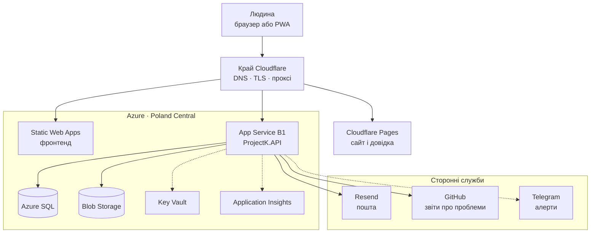
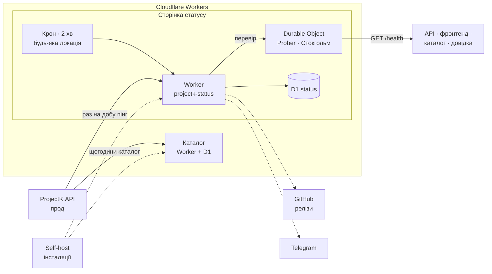

[Архітектура в діаграмах](/dev/core/architecture-diagrams/) показує, як влаштований сам моноліт. Ця
сторінка ширша: які сервіси стоять навколо нього, де кожен живе і хто з ким говорить. Лілейка
розкладена між двома хмарами. **Azure** тримає застосунок і його дані. **Cloudflare** стоїть
попереду всього як DNS і проксі, а ще тримає легкі сервіси на Workers: каталог, сторінку статусу й
сайт довідки.

## Запит людини

Людина ніколи не звертається до Azure напряму. Кожен запит спершу потрапляє на край Cloudflare в
найближчому до неї місті (з України це Варшава або Відень), і вже звідти йде далі. Пунктир — те,
що API робить у фоні, не затримуючи відповідь.

Сам App Service приймає лише IP-адреси Cloudflare: запит в обхід проксі отримає 403. Секрети API
читає не з налаштувань, а з Key Vault через посилання (`@Microsoft.KeyVault(...)`).

## Фонові зв'язки

Те, що відбувається без людини: за розкладом або раз на добу. Крон Cloudflare запускається будь-де
у світі, тому перевірки він передає Durable Object, який завжди сидить у Стокгольмі. Чому так —
на [сторінці статусу](/dev/operations/status-page/).

## Де що живе

| Сервіс | Де | Адреса | Як деплоїться |
|---|---|---|---|
| Фронтенд (Angular) | Azure Static Web Apps | `lileyka.app` | `angular.yml`: пуш у `dev` → staging, реліз → прод |
| API (`ProjectK.API`) | Azure App Service, Linux B1, Poland Central | `api.lileyka.app` | `dotnet.yml`: пуш у `dev` → staging, реліз → прод. Збірка ReadyToRun |
| База | Azure SQL, Basic (5 DTU) | — | міграції EF на старті API |
| Файли | Azure Blob Storage | підписані посилання | — |
| Секрети | Azure Key Vault `kv-projectk-prod` | — | посилання з налаштувань App Service |
| Логи | Application Insights + Telegram | — | — |
| Сайт і довідка | Cloudflare Pages | `docs.lileyka.app` | git-інтеграція Cloudflare збирає `site/` з продової гілки; `site.yml` лише перевіряє збірку |
| Статичне демо | Cloudflare Pages, разом із сайтом | `/demo/` на сайті | разом із сайтом |
| Публічне демо | окремо від проду, середовище `Demo` | — | демо-курінь, вхід без пароля (`api/demo/login`), щоночі о 03:00 UTC база повертається до засіяного стану |
| Каталог проб і вмілостей | Cloudflare Worker + D1 | `catalog.lileyka.app` | окремий репозиторій |
| Сторінка статусу і телеметрія | Cloudflare Worker + D1 + Durable Object | `status.lileyka.app` | репозиторій `ProjectK.Status`, пуш у `main` через Workers Builds |

Staging має той самий набір в іншій підписці Azure. Пастка з назвами: застосунок
`api-projectk-prod` — це **staging**, а прод називається `api-projectk-prod-new`.

## Що відбувається за розкладом

| Що | Як часто | Хто кличе кого |
|---|---|---|
| Перевірки стану | кожні 2 хв | крон → `projectk-status` → `Prober` → чотири цілі |
| Оновлення каталогу | щогодини | API → каталог, остання копія лягає на диск (`catalog-cache`) |
| Анонімний пінг телеметрії | раз на добу, перший за 5 хв після старту | API (прод і self-host) → `POST /v1/ping` |
| Найновіший реліз | щогодини | `projectk-status` → GitHub, віддається інстансам у відповіді на пінг |
| Прибирання статусу | щодня о 03:00 UTC | `projectk-status` чистить старі лічильники в D1 |
| Фонові служби API | від годин до доби | аудит, перестороги, фото-сироти, архів задач (див. [Архітектуру](/dev/core/architecture/)) |
