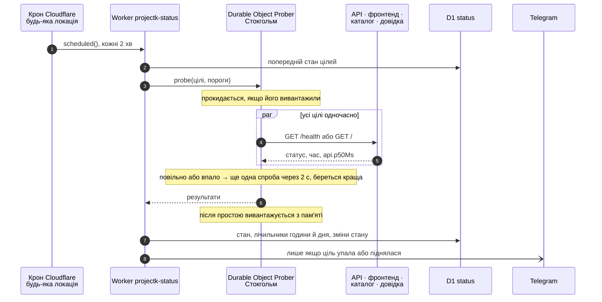
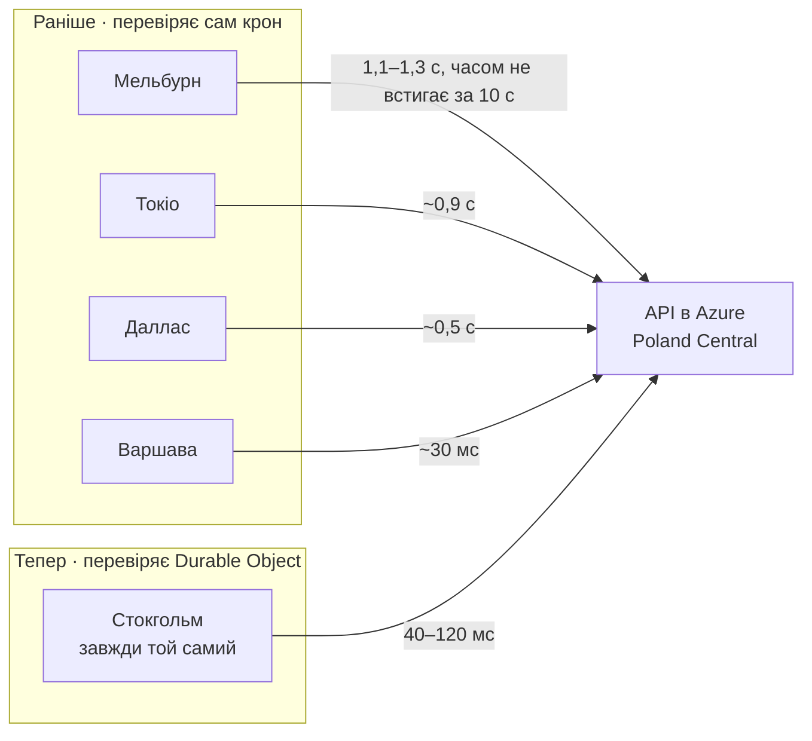

`status.lileyka.app` — окремий Cloudflare Worker у репозиторії `ProjectK.Status`. Він
кожні 2 хвилини перевіряє API, фронтенд, каталог і довідку, малює 90 днів доступності та приймає
анонімний пінг телеметрії від інстансів. Як рахується колір дня і що лежить у D1, описано в README
того репозиторію. Ця сторінка про те, **звідки** йдуть перевірки і чому саме так.

## Worker і Durable Object

Обидва — serverless: сервер не орендується, ти завантажуєш код, а Cloudflare сам вирішує, де його
запустити. Різниця в тому, **де** код запускається і **чи має він пам'ять**.

| | Worker | Durable Object |
|---|---|---|
| Де виконується | біля того, хто викликав; для крону — будь-де у світі | в одному дата-центрі, обраному при першому виклику |
| Скільки копій | скільки завгодно паралельно | рівно одна на ім'я в усьому світі |
| Стан | немає, дані лежать у D1, KV чи R2 | пам'ять, поки активний, і власна SQLite |
| Паралельність | повна | запити до одного об'єкта йдуть по черзі |
| Деплой | `wrangler deploy` | той самий: це клас усередині коду воркера |
| Скільки живе | від запиту до відповіді | код — до наступного деплою; в пам'яті — поки є запити; ім'я, місце й дані — назавжди |

Воркер не «переїжджає»: після деплою його код уже лежить у всіх ~300 дата-центрах Cloudflare і
запускається в тому, куди прийшов виклик. Для людини це найближче місто. Для крону — той
дата-центр, де в Cloudflare зараз є вільні ресурси, а це може бути будь-яке місто світу.

Durable Object — це екземпляр класу з іменем. Для одного імені в будь-який момент існує одна копія,
і живе вона там, де її створили. Після простою Cloudflare вивантажує об'єкт із пам'яті й звільняє
ресурс. Наступний виклик піднімає його знову в тому самому місці. Платиш лише за час, коли він
активний.

## Звідки йдуть перевірки

Крон лише будить воркер. Воркер віддає роботу об'єкту `Prober` з фіксованим іменем `europe` і
підказкою розташування `eeur` (Східна Європа). Cloudflare створив його в Стокгольмі, і там він
лишається. Об'єкт перевіряє цілі, повертає результати й засинає. Воркер записує їх у D1 і, якщо
треба, пише в Telegram. Сторінку читачеві віддає вже не крон, а звичайний запит до `GET /v1/status`,
який читає D1 і кешується на краю на 60 с.

Код — `src/prober.ts`. Якщо об'єкт недоступний, крон перевіряє сам і пише про це в лог, щоб
сторінка не застигла.

## Чому не з крону

Так було до 17.10.2026, і сторінка показувала те, чого не було.

Аналітика Cloudflare за 16–17.10.2026 показала:

- За добу крон побував у **34 локаціях** по світу. Час від краю Cloudflare до Azure в Польщі
  залежав лише від того, де він запустився:

  | Локація | Середній час до Azure |
  |---|---|
  | Варшава | 30 мс |
  | Відень, Франкфурт, Амстердам | 67–93 мс |
  | США | 310–600 мс |
  | Токіо, Сеул, Гонконг | 630–950 мс |
  | Сінгапур, Сідней, Мельбурн | 1,1–1,3 с |

- Сам API на `/health` витрачав 0,3 мс.
- **Усі сім «падінь» за ці дві доби** — Мельбурн, Брисбен або Токіо: код 499, Azure так і не відповів
  за 10 с, у Application Insights цих запитів немає зовсім.
- Справжні люди заходили через Відень і Варшаву, і мережевих збоїв у них не було жодного.

Тобто сторінка міряла довжину маршруту від випадкового міста до Польщі, а не здоров'я сервісу.
Прив'язати сам крон до регіону не можна: підказки розташування Cloudflare (Placement Hints) діють
лише на обробник `fetch`. Тому перевірки винесли в Durable Object: він стоїть в одному місці поряд
з користувачами, і червоне на сторінці тепер означає, що сервіс справді недоступний з Європи.

## Що означає час на графіку

- **API** віддає в `/health` поле `api`: медіану й 95-й процентиль власного часу на справжніх
  запитах за останні 15 хв (`RequestTimings`). Самі перевірки, `/` і CORS-preflight туди не
  входять. Графік API показує саме цей час, тобто скільки працює запит усередині API. Година без
  жодного запиту сіра.
- **Інші цілі** показують час відповіді на пробу зі Стокгольма. Він включає мережу, але тепер
  стабільний.
- Стан «повільно» рахується за часом відповіді на пробу (поріг 3 с), «лежить» — за помилкою або
  тайм-аутом 10 с.

## Де подивитись у Cloudflare

Назви пунктів у панелі Cloudflare час від часу змінюються.

- **Workers & Pages → `projectk-status`**:
  - прив'язки `PROBER` (Durable Object), `DB` (D1), `ASSETS`;
  - **Deployments** — версії з посиланнями на коміти;
  - **Logs / Observability** — виклики і повідомлення про запасний шлях без об'єкта.
- **Storage & Databases → Durable Objects** — клас `Prober` воркера `projectk-status`: один об'єкт,
  його запити й тривалість.
- **Storage & Databases → D1 → `status`** — таблиці зі станом і лічильниками; SQL можна писати
  прямо в браузері.
- **Analytics** зони `lileyka.app` — запити до `api` з колонкою локації (`coloCode`):
  так знайшли, що «падіння» приходили з Австралії та Японії.

## Скільки це коштує

Нічого: усе вкладається в безкоштовний план Workers з великим запасом.

| Що | Ліміт на добу | Потрібно |
|---|---|---|
| Запити до Durable Object | 100 000 | 720 |
| Тривалість Durable Object | 13 000 GB-с | ~90 GB-с |
| Записані рядки D1, на весь акаунт разом із каталогом | 100 000 | ~9 000 |

## Почитати

- Cloudflare Workers → *How Workers works* — ізоляти й те, як код потрапляє в кожен дата-центр.
- Durable Objects → *What are Durable Objects* — одна копія на ім'я, сховище, вивантаження.
- Durable Objects → *Data location* — підказки розташування на зразок `eeur`.
