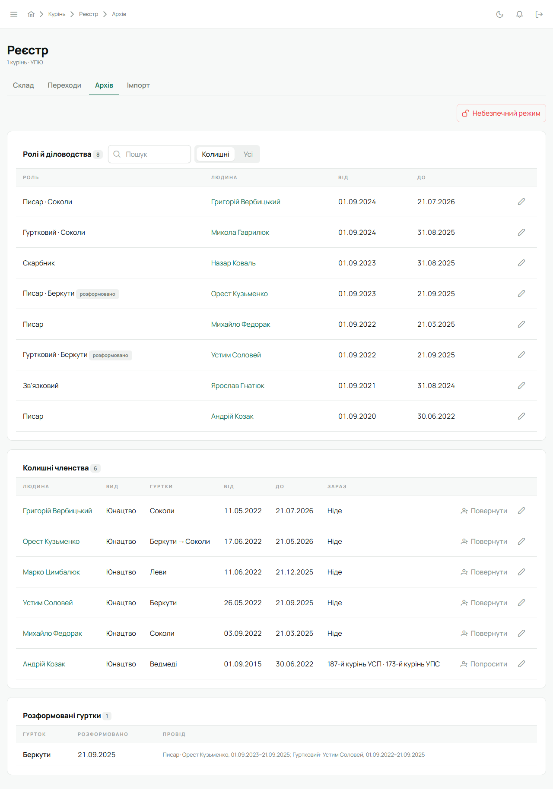
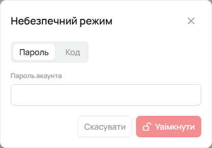
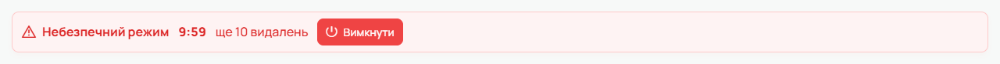

Що закінчилось у курені, не зникає: хто мав яку роль і коли, хто вийшов, які гуртки розформовано.
Усе це — у **«Реєстрі»**, на вкладці **«Архів»**. Тут виправляють дати, якщо їх записали
неправильно, повертають колишніх учасників і, в окремому режимі, видаляють записи назовсім.

## Хто що може

| | Бачить | Виправляє | Повертає колишніх | Видаляє |
|---|---|---|---|---|
| Звʼязковий | увесь архів | усе | так | у небезпечному режимі |
| Гуртковий, впорядник | записи своїх гуртків | записи своїх гуртків | — | — |

Запис про себе не виправляє й не видаляє ніхто: такий рядок позначено тегом **«своє»**.
Адміністратор у курені може те саме, що Звʼязковий.

## Ролі й діловодства

Таблиця: **Роль · Людина · Від · До**. Перемикач **«Колишні»** показує ролі, що вже закінчились,
**«Усі»** — ще й нинішні (у колонці «До» — «зараз»). Роль у гуртку, який розформували, має тег
**«розформовано»**. Пошук **«Пошук у ролях і членствах»** шукає за людиною й назвою ролі.

Нинішню роль тут не змінюють: це робиться в проводі, див.
[Записати провід куреня чи гуртка](/user/howto/assign-leadership/).

## Колишні членства

Таблиця: **Людина · Вид · Гуртки · Від · До** (у курені УПЮ «Гуртки» показують, через які гуртки
людина пройшла). У Звʼязкового є ще колонка **«Зараз»** — де людина стоїть тепер.

### Повернути колишнього

Біля останнього членства людини Звʼязковий бачить кнопку:

- **«Повернути»** — людина ніде не стоїть. Курінь УПЮ повертає її одразу: у вікні
  **«Повернути до куреня»** вибери «Юнак» чи «Впорядник» і натисни **«Повернути»**. Старший курінь
  людині з акаунтом надсилає запрошення.
- **«Попросити»** — людина вже в іншому курені. Вікно **«Попросити назад»** надсилає такий самий
  запит, як вкладка «Переходи».

Поки запит чекає відповіді, замість кнопки стоїть тег **«Запит чекає»**. Хто відповідає і що буває
з боргом — [Перевести людину між куренями](/user/howto/transfer-member/).

## Розформовані гуртки

Лише в курені УПЮ: **Гурток · Розформовано · Провід**. Гурток, який розформували кнопкою
«Розформувати», лишається тут з усім своїм проводом.

## Виправити запис

Олівець у рядку відкриває вікно **«Виправити роль»** чи **«Виправити членство»**.

- **Роль:** інша роль того самого проводу й дати **«Від»** і **«До»**.
- **Членство:** **«Вид»** (у курені УПЮ «Юнацтво» чи «Виховний склад», у старшому — «Член куреня»
  чи «Виховний склад») і дати.

Натисни **«Зберегти»**. Виправити можна лише те, що вже закінчилось. Лілейка не збереже, якщо:

- за членством є записи вкладки — **«За членством є внески»**;
- нові дати перетинаються з іншим членством цієї людини в курені — **«Дати перетинаються з іншим
  членством»**.

Кожне виправлення потрапляє в [Журнал дій](/user/features/journal/): «Виправлено роль в архіві»,
«Виправлено членство в архіві».

## Небезпечний режим

Видаляти з архіву може лише Звʼязковий і лише в небезпечному режимі. Видалене не повертається.

:::caution
Видалений запис зникає назовсім, ніби його ніколи не було. Журнал дій зберігає лише, хто, що й коли
видалив. Видаляй тільки записи, створені помилково.
:::

### Увімкнути

1. **«Реєстр»** → **«Архів»** → кнопка **«Небезпечний режим»** угорі.
2. У вікні вибери **«Пароль»** і введи **«Пароль акаунта»** або вибери **«Код»** і введи
   **«Код з автентифікатора»**. Резервний код теж підходить.
3. Натисни **«Увімкнути»**.

Код можна ввести, лише коли в тебе ввімкнено [двофакторний вхід](/user/howto/enable-mfa/);
без нього Лілейка відповість «Без двофакторного входу — лише пароль». Неправильні спроби
рахуються разом зі спробами входу: після 10 невдалих Лілейка відповість «Забагато спроб. Спробуй за
15 хвилин», і на цей час призупиниться й вхід у твій акаунт.

### Поки режим увімкнено

Угорі червона смуга **«Небезпечний режим»**: годинник з часом, що лишився, і скільки видалень ще
можна, наприклад «ще 10 видалень».

- Режим діє **10 хвилин** і дає **до 10 видалень**.
- У рядках зʼявляється кошик. Видалити можна:
  - роль, що закінчилась, — **«Видалити запис ролі?»**;
  - колишнє членство разом з ролями за цей час і гуртками — **«Видалити членство?»**. Проби,
    вмілості й вкладка людини лишаються;
  - розформований гурток з усім його проводом — **«Видалити гурток назавжди?»**.
- Кожне видалення підтверджуєш кнопкою **«Видалити»**.
- «Повернути» й «Попросити» в цей час сховано.

Членство не видалиться, якщо за ним є записи вкладки («За членством є внески») або якщо роль із
того часу ще триває («Роль із того часу ще триває»): спершу закінчи її в проводі.

### Коли режим вимикається

- натиснув **«Вимкнути»**;
- минуло 10 хвилин;
- зроблено 10 видалень;
- перейшов на іншу вкладку реєстру чи іншу сторінку, оновив або закрив сторінку.

Щоб видаляти далі, увімкни режим знову, з паролем чи кодом.

### Хто дізнається

- У **«Журналі дій»** (розділ «Архів») записано кожну спробу: «Увімкнено небезпечний режим»,
  «Невдала спроба увімкнути небезпечний режим», «Вимкнено небезпечний режим», а також кожне
  видалення: «Видалено запис ролі», «Видалено членство», «Видалено гурток назавжди». Того, що ти
  ввів, журнал не зберігає.
- Інші Звʼязкові й курінний дістають сповіщення **«Небезпечний режим архіву»** з твоїм імʼям. Воно
  веде в журнал.

## У старшому курені

Гуртків немає, тож немає таблиці «Розформовані гуртки» й колонки «Гуртки». Вид членства —
«Член куреня» чи «Виховний склад». Архів веде Звʼязковий.

## На телефоні

Архіву на телефоні немає: «Реєстр» у меню відкриває повну версію в браузері. Колишніх можна
повернути й з телефона: вкладка «Курінь» → **«Переходи»** → **«Колишні»**, торкнись людини.
