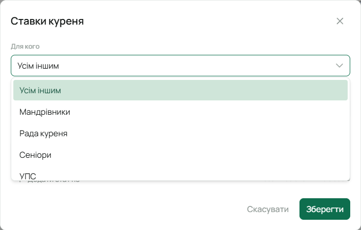
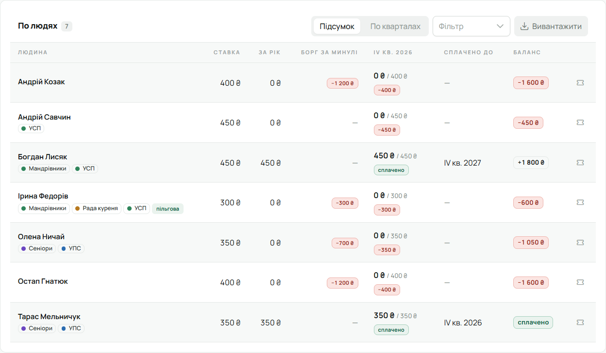
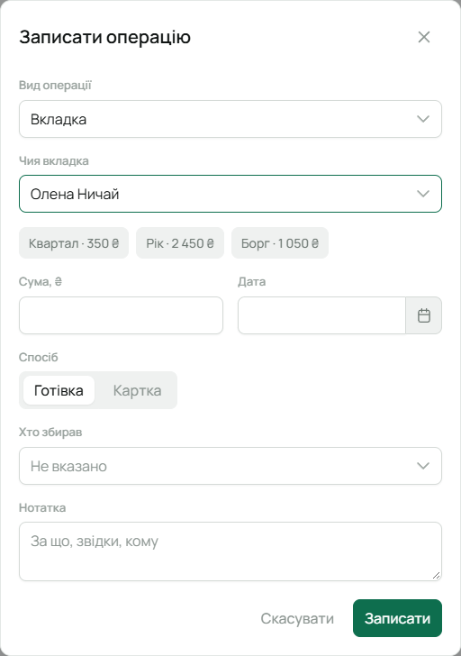

У курені УСП чи УПС гуртків немає, тож кас гуртків теж немає: кожен член має **свій рахунок просто
в касі куреня**. Вкладку платять усі, провід теж. Скарбник куреня веде одну сторінку — бічне меню
→ **«Вкладка»** — замість гурткових кас, а ставка в кожного залежить від його
[тегів](/user/features/tags/).

Загальні правила вкладки — квартали, валюта, статті, пільги, куди курінь передає гроші — ті самі,
що в УПЮ: [Вкладка](/user/features/dues/). Тут — те, що в старшому курені інакше.

## Хто що може

| | Бачить | Записує операції, ставки, пільги, «Як платимо» | «Перевірено» |
|---|---|---|---|
| Член куреня | свій баланс на картці й на головній | — | — |
| Скарбник куреня | усю сторінку | так | — |
| Звʼязковий | усю сторінку | так | так |

Скарбник може зватися в курені інакше — роль та сама ([«Назви ролей»](/user/features/senior-kurin/#назви-ролей)).

## Як рахується

- **Рахунок** — один наскрізний на людину в цьому курені: усі нарахування мінус усі внески. Борг і
  надлишок переходять з кварталу в квартал.
- **Нараховується** кожному, хто стоїть у курені, з кварталу, коли він прийшов, і не раніше першої
  ставки куреня. Котрий квартал уже нараховано, вирішує **«Як платимо»** (див. нижче).
- **Квартал коштує** стільки, скільки ставка, за якою його нараховано, — з пільгою, якщо вона є.
- **Внесок спершу закриває найстаріший квартал**, а в ньому — спершу частину станиці, потім краю, і
  лише тоді куреня.
- **Надлишок** нікуди не дівається: він сам закриває квартали, щойно їх нараховано.

## Ставки за тегом

Кнопка **«Ставки куреня»** вгорі сторінки. У вікні, крім звичних **«З кварталу»** і статей
(**«Назва»**, **«Кому»**, **«Сума»**, **«З пільгою»**), є поле **«Для кого»**: **«Усім іншим»**
або один із тегів куреня. Кожен тег має свої статті з кварталу, так само як ставка для всіх.
**«Кому»** — «Станиці», «Краю» чи «Куреню», як дозволяє край.

Котру ставку платить людина:

- **Немає жодного тегу зі ставкою** — платить **«Усім іншим»**. Тег, для якого ставки не задано,
  нічого не змінює.
- **Один тег зі ставкою** — платить ставку цього тегу.
- **Кілька тегів зі ставками** — платить **вищу**. Ставки порівнюються за повною сумою всіх статей
  (без пільги), чинною в цьому кварталі.

Під числами каси видно ставки, чинні зараз: кожен тег зі своєю сумою і **«Усім іншим»**.

### Коли ставка змінюється

Кожен нарахований квартал записаний за ставкою якогось тегу. Перерахувати його можуть такі зміни:

| Що сталося | Що перераховується |
|---|---|
| людині поставили чи зняли тег | лише останній нарахований квартал, якщо його не сплачено повністю |
| задали ставку з якогось кварталу | усі несплачені квартали від нього |
| тег видалили | усі несплачені квартали всіх людей |
| людина вийшла з куреня | нічого: її борг лишається таким, яким був |

Сплачений повністю квартал лишається за тим тегом, за яким його сплатили.

Якщо теги в курені [вимкнено](/user/features/tags/#увімкнути-теги), нові квартали йдуть за ставкою
«Усім іншим», а ставок тегів на сторінці не видно. Поставити ставку тегу при вимкнених тегах не можна.

## Як платимо

Під ставками — перемикач **«Як платимо»** (змінює той, хто задає ставки; решта бачить вибране):

- **«Наперед»** — квартал нараховується, щойно почався;
- **«За пройдений квартал»** — квартал нараховується, коли минув: на початку IV кв. платять за III.

Неоплачений квартал, у якому людину виведено, знімається; оплачений лишається за нею.

## Каса куреня

Угорі — кількість членів і скільки з них **«з боргом»**. Далі числа каси:

- **«У касі»** — усе разом, окремо готівка й картка;
- **«Курінні»** — гроші куреня, які можна витрачати;
- **«До передачі в станицю»** і **«До передачі в край»** — частини внесків, що належать станиці й
  краю, і скільки вже **передано**. Показуються, коли є що передавати;
- **«Сплачено наперед»** — що люди заплатили за квартали, які ще не настали. Ці гроші не входять у
  «Курінні»: коли квартал настане, частина їх піде станиці й краю.

Плиток «Гуртки», «По кварталах» гуртків і «Передачі від гуртків» тут немає.

## Реєстр «По людях»

Рядок на людину, теги — біля імені, там же позначки **«пільгова»** й назви пільг краю.

**«Підсумок»** — колонки:

| Колонка | Що в ній |
|---|---|
| **Ставка** | скільки людина платить за поточний квартал |
| **За рік** | скільки сплачено за квартали вибраного пластового року |
| **Борг за минулі** | що винна за квартали, які вже минули; поточний сюди не входить |
| поточний квартал | сплачено / нараховано і що лишилось |
| **Сплачено до** | останній квартал, закритий повністю, рахуючи надлишок за поточною ставкою; поки є борг — «—» |
| **Баланс** | рахунок людини: «сплачено», борг червоним, надлишок з плюсом |

**«По кварталах»** — замість цього колонка на кожен квартал вибраного пластового року: сплачено /
нараховано і залишок. Пластовий рік вибирають угорі сторінки.

- **«Фільтр»** — теги куреня й **«З боргом»**. Кілька тегів — люди з будь-яким із них.
- **«Вивантажити»** зберігає відфільтрований реєстр у файл CSV, який відкриває Excel: людина, теги,
  ставка за квартал, сплачено за рік, борг за минулі, поточний квартал, «Сплачено до», баланс.
- Під таблицею — **«Переведені й вибулі з боргом»**: ті, хто пішов з куреня, винним.
- Клік по рядку лишає в **«Операціях куреня»** лише операції цієї людини.
- Значок **«Пільга»** в кінці рядка відкриває вікно **«Пільги»** — пільга куреня й пільги краю, як
  у [касі гуртка](/user/features/dues/#ставки-й-пільга).

## Записати операцію

**«Записати операцію»** вгорі. Крім витрат, іншого приходу, передач у станицю чи край і обміну
готівки й картки, тут є особисті операції: **«Вкладка»**, **«Повернення»** й **«Корекція»** — для них
обираєш **«Чия вкладка»**.

Для вкладки вікно пропонує **готові суми** людини:

- **«Квартал»** — її ставка за поточний квартал;
- **«Рік»** — чотири квартали наперед: чотири ставки мінус те, що вже є на рахунку (борг додається,
  надлишок віднімається);
- **«Борг»** — увесь борг на рахунку, якщо він є.

Операцію можна змінити чи видалити, доки Звʼязковий не позначив її **«Перевірено»**.

## Наперед

Людина може заплатити скільки завгодно наперед. Надлишок лежить на її рахунку й показаний у касі як
**«Сплачено наперед»**, а в реєстрі — у **«Сплачено до»**. Щойно настає новий квартал і його
нараховано, надлишок сам його закриває.

## Борг і вихід з куреня

Людину з боргом **за квартали, що минули**, не можна ні **«Вивести»** з куреня, ні відпустити на
**«Перевести до нас»** в інший курінь: Лілейка покаже **«Спершу — вкладка»**. Борг не переходить
разом із людиною — спершу його сплачують. Поточний квартал вихід не блокує. Коли курінь УПЮ
приймає людину ще й до себе впорядником, борг цьому не заважає: зі старшого куреня вона не йде.

Коли платите **«За пройдений квартал»**, щойно минулий квартал нараховано, він уже «минулий»: поки
його не сплачено, людину не вивести.

Детально — [Вивести з куреня](/user/howto/membership/#вивести-з-куреня),
[Перевести людину між куренями](/user/howto/transfer-member/).

## Розібраний приклад

Курінь вигаданий, правила — справжні. Край передає вкладку «Станиці, а вона — краю», курінь платить
**«Наперед»**. Ставки з I кв. 2026:

| Для кого | Станична вкладка (Станиці) | Курінна вкладка (Куреню) | Разом |
|---|---|---|---|
| Усім іншим | 150 грн | 100 грн | 250 грн |
| УСП | 150 грн | 150 грн | 300 грн |
| УПС | 150 грн | 250 грн | 400 грн |

**Ліда** має теги «УСП» і «УПС» — платить вищу ставку, **400 грн**. Андрій має лише тег «Провід»,
для якого ставки немає, — платить «Усім іншим», 250 грн.

**1. Прийшла в курінь.** Ліда стала членом 10 травня 2026, у II кв. Курінь платить наперед, тож на
15 серпня їй нараховано II і III кв. — по 400 грн, разом 800.

**2. Перший внесок.** 20 травня Ліда дала 500 грн. Внесок іде на найстаріший квартал:

| Квартал | Нараховано | Сплачено | Залишок |
|---|---|---|---|
| II кв. 2026 | 400 (станиці 150, куреню 250) | 400 | сплачено |
| III кв. 2026 | 400 (станиці 150, куреню 250) | 100 — уся на частину станиці | −300 |

Рахунок: 500 − 800 = **−300 грн**. У реєстрі в серпні: «Ставка» 400, «За рік» 500 (II і III кв.
належать до пластового року «25–26»), «Борг за минулі» — нема, бо III кв. поточний, «III кв. 2026»
100 / 400, «Сплачено до» — «—», «Баланс» −300. У касі з 500 грн станиці належать 250, тож «До
передачі в станицю» 250, «Курінні» 250.

**3. Настав IV кв.** 1 жовтня нараховано IV кв., 400 грн. Рахунок −700 грн, з них «Борг за минулі»
— 300 (III кв.). Вивести Ліду чи відпустити в інший курінь зараз не можна — «Спершу — вкладка».

> А якби 5 жовтня з Ліди зняли тег «УПС»? Її IV кв. ще не сплачено, тож він перерахувався б за
> «УСП» — 300 грн. III кв. лишився б за 400: тег змінює лише останній нарахований квартал.
> Рахунок був би −600.

**4. Оплата на рік.** Скарбник записує внесок і бачить готові суми: «Квартал · 400», «Рік · 2 300»
(4 × 400 + 700 боргу), «Борг · 700». Ліда платить «Рік» — 2 300 грн. Вони закривають решту III кв.
(300), увесь IV кв. (400), а 1 600 лишаються надлишком.

Тепер «Баланс» **+1 600**, «Сплачено до» — **IV кв. 2027** (IV кв. 2026 і ще 1 600 / 400 = 4
квартали). У касі ці 1 600 видно як «Сплачено наперед», у «Курінні» вони не входять. 1 січня 2027
нараховано I кв. — надлишок сам його закриває, і «Сплачено наперед» стає 1 200.

## Що бачить член куреня

На своїй [картці](/user/features/member-card/) й на [головній](/user/features/dashboard/) член
бачить свій рахунок у курені: «Сплачено», борг із підказкою «віддай скарбникові» або надлишок, що
піде на наступний квартал, ставку поточного кварталу й останні внески. Чужих рахунків і каси він
не бачить. Хто стоїть у кількох куренях, бачить рахунок кожного куреня окремо.

## На телефоні

Свій баланс член бачить і на телефоні. Скарбникові пункт **«Вкладка куреня»** в меню телефона
відкриває цю сторінку у браузері: окремого екрана для каси старшого куреня в застосунку немає.
