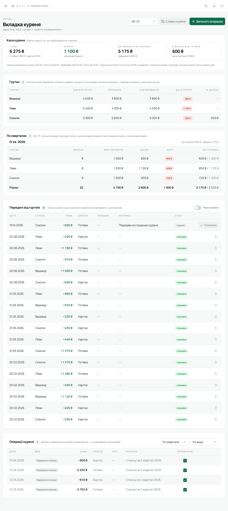

Вкладка — внесок юнака за квартал. Він складається з частин: **станична**, **курінна** й
**гурткова**, а якщо курінь платить крайовий внесок окремо від станиці, то ще й **крайова**. Лілейка нараховує її щокварталу, приймає внески, показує борг і надлишок кожного юнака
і веде дві каси: **гуртка** й **куреня**.

## Як рахується

- **Квартал** — календарний: січень–березень, квітень–червень, липень–вересень, жовтень–грудень.
  Новий квартал починається опівночі за часовим поясом краю, а не за UTC. Пластовий рік (з IV
  кварталу) — лише спосіб згрупувати таблицю, на гроші він не впливає.
- **Суми** — у валюті краю й записані так, як край пише числа (розділювач тисяч і копійок). Обидва
  задає адміністратор у налаштуваннях краю.
- **Ставки діють з кварталу** й до наступної зміни. Курінь задає свої **статті** вкладки, однаково
  для всіх гуртків: назву, куди йдуть гроші (станиці, краю чи куреню), повну суму й суму з
  пільгою. Наприклад, «Станична вкладка», «Крайова вкладка», «Табірний фонд». Станична частина — це
  сума статей «станиці», крайова — статей «краю», курінна — статей «куреню». Гурткову частину кожен
  гурток задає сам.
- **Куди курені передають вкладку**, вирішує край — це налаштування краю (його задає
  адміністратор):
  - **«Станиці, а вона — краю»** — як було завжди: усе, що йде вгору, — статті «станиці»;
  - **«Напряму краю»** — для краю без станиць: статті йдуть «краю», у касі куреня немає станиці,
    а гроші вгору передають операцією «Передача в край»;
  - **«І станиці, і краю — за статтями»** — частину статей курінь віддає станиці, частину передає
    краю сам; у касі куреня ці гроші лічаться окремо.

  Зміна налаштування не переписує вже задані статті: курінь побачить, яку статтю треба перевести,
  коли наступного разу змінюватиме ставки.
- **Пільгова вкладка** бере для кожної статті її суму з пільгою; гурткову частину пільга не змінює.
  Пільгу вмикають людині з певного кварталу.
- **Пільги краю** — власні пільги й знижки, які адміністратор задає в налаштуваннях краю, у розділі
  «Пільги краю»: знижка у відсотках, знижка на суму за квартал або повне звільнення, кожна на
  вибрані частини вкладки (станиця, край, курінь, гурток). Людині їх надають у гуртку з певного
  кварталу, за бажанням до певного, і з підставою. Знижка на суму ділиться між вибраними частинами
  пропорційно до них. Правило копіюється на кожну надану пільгу, тож його зміна діє лише на пільги,
  надані після збереження. «Звіт про пільги» там же показує за квартал, скільки людей у куренях
  краю має кожну пільгу і на скільки зменшилась кожна частина вкладки.
- **Діє найвигідніша пільга.** Якщо в людини кілька пільг, рахується кожна окремо від повної
  вкладки, і квартал коштує стільки, скільки найменша з цих сум.
- **Нарахування** йде кожному юнакові гуртка з кварталу, коли він прийшов, і не раніше першої
  ставки куреня.
- **Баланс — один наскрізний рахунок** людини в курені. Борг переходить на наступний квартал, і
  надлишок теж, навіть через межу пластового року.
- **Внесок спершу закриває найстаріший квартал**, а в ньому — спершу станичну частину, потім
  крайову, курінну й лише тоді гурткову. Поки станиця, край і курінь не отримали свого, гурток зі
  внеску не має нічого.
- Людина, яку перевели в інший гурток, лишає старому гуртку свій борг за ті квартали, коли була там.
- **Валюта** — та, що задана для краю куреня (типово гривня). Її встановлює адміністратор у
  [«Краї»](/user/roles/admin/#краї); усі суми вкладки куреня показуються в ній.

## Каса гуртка

«Вкладка гуртка» в бічному меню. Хто веде кілька гуртків (скарбник куреня, Звʼязковий), бачить
згортку «Вкладка гуртків» з пунктом на кожен гурток.

**Каса** вгорі — чотири числа:

- **У касі** — усе разом, окремо готівка й картка;
- **Гурткові** — гроші гуртка, їх можна витрачати;
- **До передачі курінному** — станична, крайова й курінна частини, що ще лежать у гуртку;
- **Передано курінному** — що вже передали і скільки з цього курінь підтвердив.

**Таблиця по кварталах** — рядок на юнака: нараховано, сплачено, баланс. Нуль — зеленим, борг —
червоним. Позначки «пільгова», «переведений» чи «вибув» стоять біля імені. Клік по юнакові фільтрує
історію його операціями.

**Історія** — усі операції з фільтрами за видом і людиною. Види операцій:

| Вид | Що це |
|---|---|
| Вкладка | внесок юнака |
| Повернення | надлишок, який віддали юнакові |
| Передача курінному | станична, крайова й курінна частини пішли скарбникові куреня |
| Витрата | гроші гуртка на ремонт, їжу, дорогу |
| Інший прихід | гроші в касу не від юнаків |
| Обмін готівка ↔ картка | переклали з готівки на картку чи навпаки |
| Корекція | виправлення помилки в балансі, у плюс чи в мінус |

У кожної операції є дата, хто збирав, сума, готівка чи картка й нотатка.

### Записати операцію

1. **«Записати операцію»** вгорі сторінки.
2. Обери **«Вид операції»**, **«Чия вкладка»** (для вкладки, повернення й корекції), суму, дату,
   **«Спосіб»** (готівка чи картка), **«Хто збирав»** і, за бажанням, нотатку.
3. **«Записати»**.

Операцію можна змінити або видалити, доки її не позначено «Перевірено». Видалена операція зникає з
каси, але запис про неї лишається в історії змін. «Передачу курінному», яку скарбник куреня вже
прийняв, гурток не змінить і не видалить: замість кнопок біля неї замок. Щоб її виправити,
курінний спершу знімає підтвердження у своїй касі.

### Перевірено

Впорядник гуртка ставить галочку в колонці **«Перевірено»**, коли звірив операцію з грошима. Позначена операція
замкнена — змінити її вже не можна. Помилку в перевіреній операції виправляють корекцією.

### Ставки й пільга

- «Ставка гуртка» — гурткова частина з вибраного кварталу.
- «Ставки куреня» — статті вкладки куреня: назва, кому (станиці, краю чи куреню), сума і сума з
  пільгою.
  «Додати статтю» додає рядок, кошик прибирає його; внизу видно, скільки разом. Цю кнопку бачать
  лише скарбник куреня та Звʼязковий. Куди може йти стаття, залежить від налаштування краю. У
  застосунку на телефоні ставки куреня змінюються, лише поки статті стандартні («Станиця» чи «Край»
  і «Курінь»); свої статті курінь змінює у вебверсії.
- **Пільга** — значок у кінці рядка юнака в таблиці по кварталах. Відкриється вікно **«Пільги»**:
  - угорі пільга куреня — перемикач «Пільгова / Повна вкладка», квартал, з якого це діє, і
    **«Зберегти пільгу куреня»**. Історія пільги зберігається;
  - нижче **«Пільги краю»**: уже надані з правилом, кварталами й підставою та **«Надати пільгу»** —
    обери пільгу краю, **«З кварталу»**, за бажанням **«До кварталу»** і **«Підставу»**, потім
    **«Надати»**. **«Змінити»** біля наданої задає їй останній квартал чи іншу підставу;
    **«Видалити»** прибирає пільгу, надану помилково, з усіх кварталів. Щоб пільга просто
    перестала діяти, задай їй останній квартал.

  Чинні пільги краю стоять біля імені юнака в таблиці, на його картці та в «Моїй вкладці».

## Каса куреня

«Вкладка куреня» в бічному меню — для скарбника куреня й Звʼязкового.

- **Каса куреня** — «У касі» (готівка й картка), «Курінні» (можна витрачати), «До передачі в
  станицю» (і скільки вже передано) та «В дорозі від гуртків». Коли край приймає вкладку напряму,
  зʼявляється ще «До передачі в край», а в краї без станиць «До передачі в станицю» зникає. Гроші, що надійшли від гуртка,
  спершу покривають станичну частину, потім крайову, і лише тоді курінну.
- **Гуртки** — рядок на гурток: скільки зібрано вгору, передано, підтверджено, ще в гуртку й у
  дорозі. Клік по рядку фільтрує передачі лише цього гуртка.
- **Передачі від гуртків** — що гуртки передали. Коли гроші справді дійшли, скарбник куреня
  позначає передачу **«Отримано»**. Доти вона «в дорозі».
- **Операції куреня** — власні витрати й приходи куреня, передача в станицю чи в край, обмін
  готівки й картки. «Перевірено» тут ставить Звʼязковий.
- **По кварталах** — для кожного кварталу вибраного пластового року рядок на гурток: скільки
  юнаків, скільки гурток має передати, скільки здав, борг і скільки зібрано для станиці (і для
  краю, якщо курінь передає йому окремо). Рядок «Разом» показує, скільки курінь загалом винен
  станиці й краю за квартал.

## Хто що може

| | Бачить | Веде касу | Перевірено |
|---|---|---|---|
| Юнак | лише свій баланс на картці й на головній | — | — |
| Гуртковий, скарбник гуртка | касу свого гуртка | так | — |
| Впорядник гуртка | касу свого гуртка | так | так |
| Скарбник куреня | каси всіх гуртків і курінну | курінну | — |
| Звʼязковий | усе | усі | так |

## Що бачить юнак

На своїй [картці](/user/features/member-card/) й на [головній](/user/features/dashboard/) юнак
бачить свій баланс: «Сплачено», борг із підказкою «віддай скарбникові гуртка» або надлишок, який
піде на наступний квартал. Там же — ставка поточного кварталу й останні внески. Чужих балансів і каси
гуртка юнак не бачить.

## На телефоні

«Меню» → «Вкладка гуртка» чи «Вкладка куреня». Каса гуртка має вкладки **«Каса / Юнаки /
Історія»**, каса куреня — **«Каса / Гуртки / Передачі / Історія»**. Записати операцію, позначити
«Перевірено» й «Отримано» можна й з телефона.

:::tip[Нарахувань немає?]
Нарахування починаються з кварталу першої ставки куреня. Поки ставок куреня не задано, таблиця
порожня.
:::
