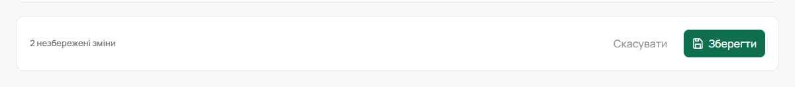
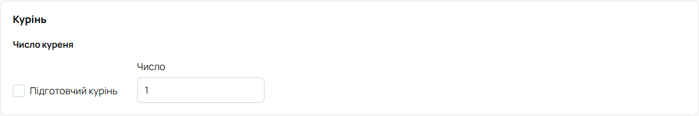
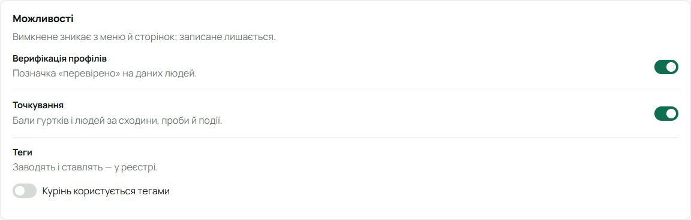
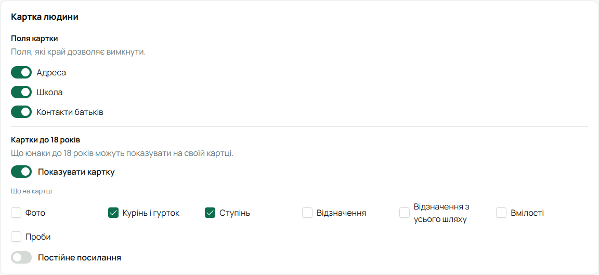
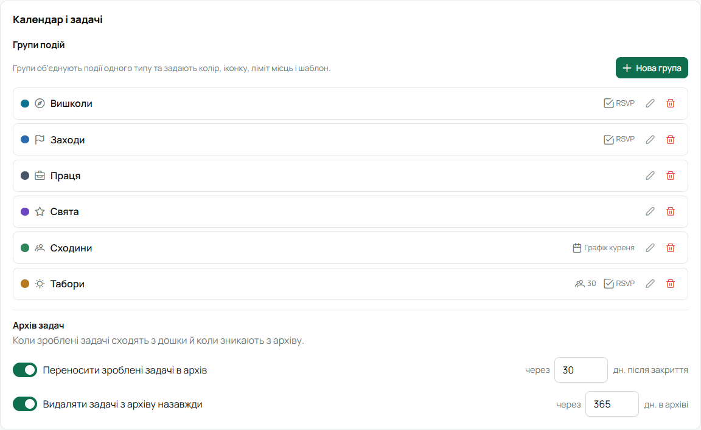
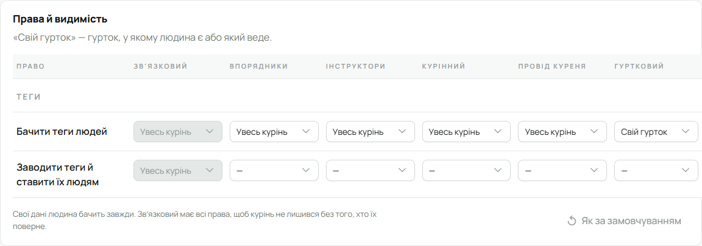

Бічне меню → **«Налаштування»** → вкладка **«Курінь»**. Поруч — вкладка **«Акаунт»** з твоїми
власними налаштуваннями. Сторінка зібрана в пʼять блоків: **«Курінь»**, **«Можливості»**,
**«Картка людини»**, **«Календар і задачі»**, **«Права й видимість»**.

## Хто бачить і хто змінює

| Хто | Що може |
|---|---|
| Звʼязковий, адміністратор | бачить і змінює все |
| Уся КВ — впорядники, інструктори | бачить сторінку цілою, з позначкою **«Лише перегляд»**; перемикачі неактивні, панелі «Зберегти» немає |
| Решта | вкладки «Курінь» не бачить |

## Панель «Зберегти»

Майже всі зміни на сторінці зберігаються разом. Змінюй що треба в будь-яких блоках, а панель
внизу показує, скільки змін не збережено: «1 незбережена зміна», «3 незбережені зміни». **«Зберегти»** записує все разом,
**«Скасувати»** повертає на сторінку куреня без збереження.

Окремо, своїми кнопками, зберігаються лише дві речі: групи подій (у їхньому вікні) і запит про
улади й числа в старшому курені.

Кожне збереження лягає в [журнал дій](/user/features/journal/) з фільтром «Налаштування куреня»:
«Змінено налаштування куреня», «Змінено поля картки», «Змінено строки архіву задач», «Змінено
пробу гуртка», «Змінено налаштування тегів», «Змінено права й видимість» — що було і що стало.

## Курінь

- **«Число куреня»** — поле **«Число»** і позначка **«Підготовчий курінь»**. Підготовчий курінь
  числа не має; зніми позначку — і впиши число. Зайняте число не збережеться: «Курінь з числом …
  уже є в Лілейці. Перевір число.» Детально —
  [Підготовчий курінь](/user/howto/preparatory-kurin/).

## Можливості

Вимкнене зникає з меню й сторінок; записане лишається і повернеться, щойно увімкнеш знову.

- **«Верифікація профілів»** — позначка «перевірено» на даних людей. За замовчуванням вимкнено.
  Як перевіряти — [Верифікувати дані](/user/howto/verify-profile/).
- **«Точкування»** — бали гуртків і людей за сходини, проби й події. В УПЮ увімкнено за
  замовчуванням. Детально — [Точкування](/user/features/score/).
- **«Теги»** — **«Курінь користується тегами»** і, коли ввімкнено, **«Кожен бачить свої теги»**.
  Заводять і ставлять теги в реєстрі. Детально — [Теги куреня](/user/features/tags/).
- **«Проба гуртків»** — якою пробою йде кожен гурток, поки край переходить на оновлену. Розділ
  видно, лише коли твій край пропонує більше однієї проби. Біля гуртка — вибір проби, «зміниться
  після «Зберегти»» і **«Хто якою пробою піде»**. Детально —
  [Проба гуртка](/user/features/probes-and-badges/#проба-гуртка).

## Картка людини

- **«Поля картки»** — поля, які край дозволяє вимкнути: те, що край має необовʼязковим (типово
  «Адреса», «Школа», «Контакти батьків»), і необовʼязкові додаткові поля краю. Вимкнене поле зникає
  з картки й форми. Те, що край вимагає, прибрати не можна; якщо такого нема — «Край вимагає всі
  поля картки, тож прибрати тут нічого.»
- **«Картки до 18 років»** — що юнаки до 18 років можуть показувати на своїй картці:
  - **«Показувати картку»** — головний перемикач. Поки курінь його не ввімкнув, неповнолітні
    картку не показують;
  - **«Що на картці»** — «Фото», «Курінь і гурток», «Ступінь», «Відзначення», «Відзначення з усього
    шляху», «Вмілості», «Проби»;
  - **«Постійне посилання»** — чи можна, крім показу картки, зробити ще й постійне посилання.

  Що показувати на своїй картці, повнолітні вирішують самі. Як показати картку —
  [Показати картку й поділитися нею](/user/howto/share-card/).

## Календар і задачі

- **«Групи подій»** — список груп з кольором; **«Нова група»**, олівець і кошик біля кожної. Група
  зберігається у своєму вікні, не панеллю внизу. Детально — [Групи подій](/user/howto/event-groups/).
- **«Архів задач»**:
  - **«Переносити зроблені задачі в архів»** — через скільки днів після закриття (за
    замовчуванням 30);
  - **«Видаляти задачі з архіву назавжди»** — через скільки днів в архіві (за замовчуванням 365).

  Строк — від 1 до 3650 днів. Вимкнеш перемикач — задачі лишаються на дошці чи в архіві без
  строку. Де архів — [Задачі](/user/features/calendar-and-tasks/#пошук-фільтри-й-архів).

## Права й видимість

Таблиця прав: хто бачить особисті дані, хто дає перестороги й відзначення, хто підписує проби,
хто кому призначає події й задачі, хто читає журнал, хто бачить і ставить теги. Для кожної
аудиторії — «—», «Свій гурток» чи «Увесь курінь»; «Свій гурток» — гурток, у якому людина є або
який веде. Як це налаштувати й що стоїть за замовчуванням —
[Права й видимість у курені](/user/howto/access-policy/).

## У старшому курені

- Заголовок сторінки — імʼя куреня або його улади, а не число.
- У блоці «Курінь» замість числа — **«Улади й числа»**: «Змінює адміністратор за запитом.»
  **«Подати запит»** відкриває форму з **«УСП»** і **«УПС»** (кожен зі своїм числом) і полем
  «Коментар для адміністратора (не обовʼязково)»; **«Надіслати запит»** відсилає її одразу, без
  панелі «Зберегти». Поки адміністратор не вирішив, видно «Чекає рішення адміністратора: …», а
  кнопка стає **«Подати інший запит»**. Позначки «Підготовчий курінь» немає.
- Там само — **«Назви ролей»**: свої назви для ролей куреня (Курінний, Суддя, Писар, Скарбник,
  Хорунжий, Господар, Хронікар, Інструктор, Звʼязковий, Впорядник, Інша курінна роль). Права ті
  самі; порожнє поле — звична назва. В УПЮ цього розділу немає.
- «Точкування» — бали людей за сходини й події; за замовчуванням вимкнено. «Теги» за
  замовчуванням увімкнено.
- Немає «Проби гуртків» і «Карток до 18 років».
- У «Правах і видимості» немає групи «Проби й вмілості», «Дані юнаків» звуться «Особисті дані», а
  колонка «Юнаки» — «Члени куреня».
- Емблему ставлять не тут, а на сторінці куреня: **«Редагувати»** → **«Завантажити емблему»**.

Повна картина відмінностей — [Старший курінь](/user/features/senior-kurin/).

## На телефоні

У застосунку пункт **«Налаштування куреня»** є для тих самих людей, що й у вебі, і відкриває
сторінку у вебверсії в браузері.
