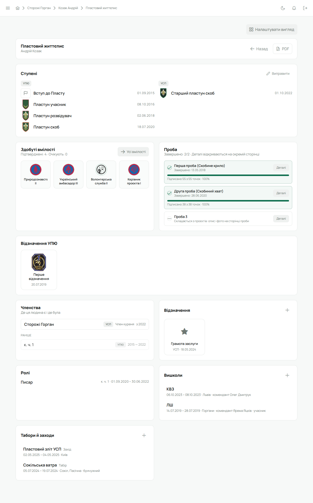

Картка каже, хто ти зараз. Життєпис — увесь шлях: від вступу до Пласту через юнацтво до старших
уладів, у всіх куренях, де ти був. Більшість зібрано з того, що вже є в Лілейці; вишколи, табори
й заходи дописуєш сам.

Відкрити: своя картка → **«Ще»** (три крапки в шапці) → **«Пластовий життєпис»**.

## Хто що може

| | Ти | Провід, Звʼязковий, адміністратор |
|---|:-:|:-:|
| відкрити свій життєпис | ✓ | |
| дописати вишколи, табори й заходи | ✓ | |
| скласти PDF | ✓ | |

Життєпис бачиш лише ти. Якщо відкрити посилання на чужий життєпис, Лілейка покаже картку цієї
людини. Вписані тобою вишколи, табори й заходи видно лише в життєписі й PDF.

## Що на сторінці

Угорі — **«Назад»** (до картки) і **«PDF»**. Плитки можна переставити й сховати через
**«Налаштувати вигляд»**, як на картці; цей вигляд окремий від вигляду картки.

| Плитка | Звідки береться |
|---|---|
| **«Ступені»** | усі ступені з датами, по уладах: УПЮ (від «Вступу до Пласту»), далі УСП й УПС, якщо є |
| **«Здобуті вмілості»**, **«Проба»**, **«Відзначення УПЮ»** | юнацтво: те саме, що на картці юнака |
| **«Відзначення»** | відзначення УСП/УПС, якщо ти вже в УСП чи УПС |
| **«Членства»** | де ти є і де був, у кожному курені |
| **«Ролі»** | ролі в КВ, проводі й гуртках у всіх куренях, з датами «від – до» чи «зараз» |
| **«Вишколи»** | вписуєш сам |
| **«Табори й заходи»** | вписуєш сам |

У юнака плитка «Ступені» має лише УПЮ, а відзначень УСП/УПС немає зовсім. Ступінь, який ще чекає
підтвердження, у життєпис не потрапляє, поки його не підтвердять, див.
[УПЮ, УСП, УПС](/user/features/branches/).

**Виправити, що не так:**

- ступені — **«Виправити»** на плитці «Ступені», якщо тобі можна редагувати свою картку
  (відкривається та сама форма, що й «Редагувати»);
- ролі й членства — у [архіві куреня](/user/features/archive/). Якщо маєш доступ до архіву, на
  плитці «Ролі» є кнопка **«Архів куреня»**.

## Вишколи

На плитці **«Вишколи»** — «+» (**«Додати вишкіл»**). У вікні **«Новий вишкіл»**:

- **«Вишкіл»** — один із: **ЛШ**, **ШБ**, **КВЗ**, **КВВ**, **РОВ**, **КВДЧ**, **«Інший»**. Для
  «Іншого» зʼявиться **«Назва»**;
- **«Число вишколу»** — порядкове число, як-от 12 для 12-го КВЗ (необовʼязково);
- **«Від»** і **«До»** — потрібна лише дата початку;
- **«Місце»**, **«Комендант»**, **«Роль»** (типово «учасник»).

**«Зберегти»**. Рядок вишколу показує назву, дати, місце, коменданта й роль. Натисни на рядок, щоб
виправити; кнопка з кошиком у тому ж вікні видаляє запис одразу, без перепитування.

## Табори й заходи

Те саме на плитці **«Табори й заходи»** («+», **«Додати табір чи захід»**): у полі **«Що»** —
**«Табір»** чи **«Захід»**, далі **«Назва»** (обовʼязкова), дати, місце, комендант і роль.

Усього в життєписі може бути до 500 записів.

## PDF

Кнопка **«PDF»** угорі складає все в один документ: розділи «Членства», «Ступені», «Ролі»,
«Відзначення», «Проби», «Вмілості», «Вишколи», «Табори», «Заходи». У кожному — від найдавнішого до
теперішнього; порожні розділи пропущено. Ролі названо так, як їх назвав курінь. Файл зветься
`zhyttiepys-РРРРММДД.pdf`.

## На телефоні

У застосунку на телефоні життєпису немає: відкрий Лілейку в браузері.

## У старшому курені

На картці члена старшого куреня юнацтва немає: проби, вмілості й відзначення УПЮ видно лише в
життєписі, і змінити їх там не можна. Детально —
[Старший курінь](/user/features/senior-kurin/).
