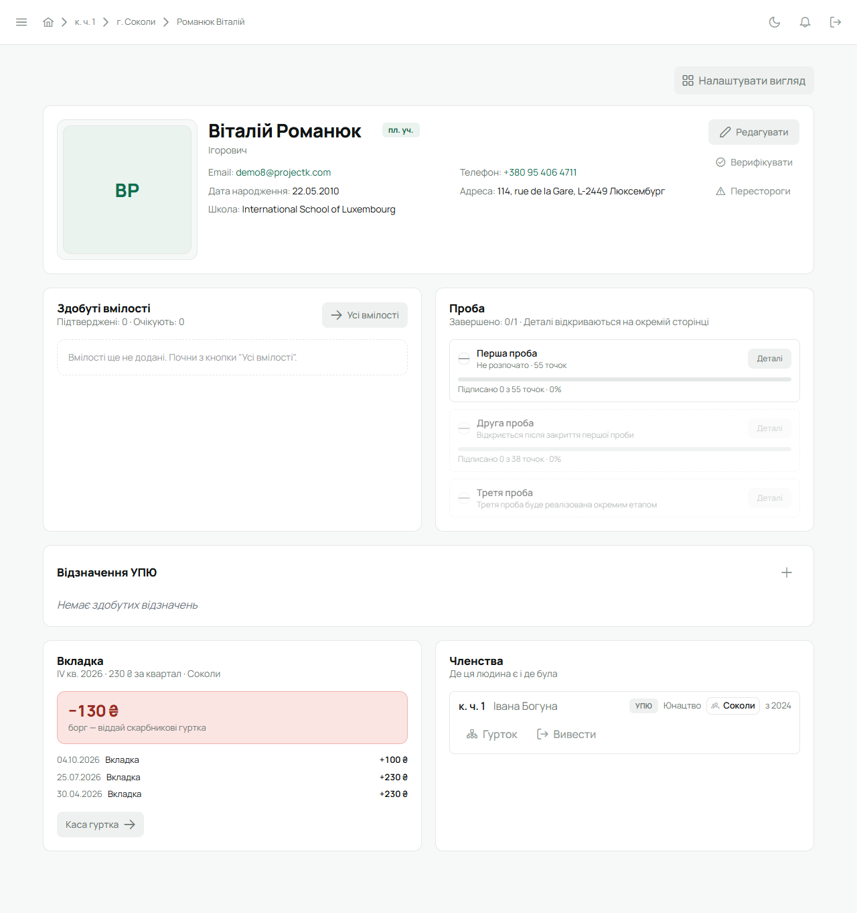
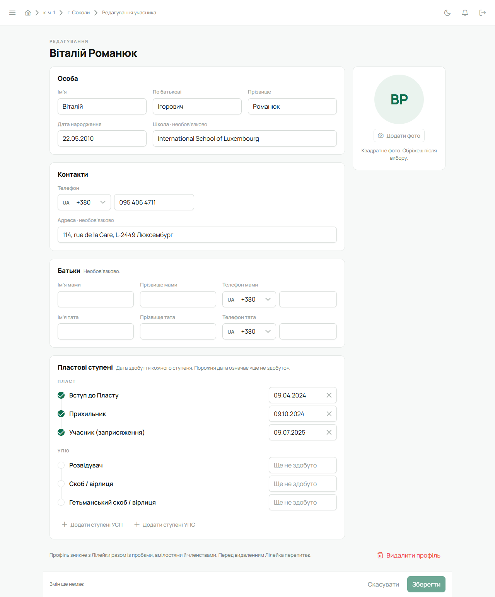

Картка відкривається зі списку учасників куреня чи гуртка, з реєстру або як «Мій профіль».
Це джерело правди про людину: усе, що про неї знає Лілейка, зібране тут.

## Шапка

- **Фото** або ініціали, якщо фото немає.
- **Імʼя**, по батькові, **ступінь** (тег поруч з імʼям).
- **Email, телефон, дата народження.** Телефон показується з кодом країни, як-от
  +380 50 123 45 67; натисни на нього, щоб подзвонити.
- **Адреса, школа, батьки** («Мама», «Тато» — імʼя й телефон) і **поля краю** — якщо вони
  заповнені. Ці дані бачать лише сама людина, Звʼязковий (і адміністратор) та впорядник її
  гуртка. Іншим членам куреня їх не видно.
- **Верифікація** — значок біля імені й рядок «Верифіковано», якщо в курені увімкнена перевірка
  профілів. Див. [нижче](#верифікація).
- **Перестороги** — три крапки біля імені; наведи, щоб побачити рівень і скільки днів лишилось.
  Див. [Пересторога](/user/howto/warning/).

Поля, яких край не веде або які курінь сховав у
[налаштуваннях куреня](/user/roles/leader/#6-налаштування-куреня), на картці не показуються зовсім.

Праворуч у шапці — кнопки для тих, хто може змінювати картку: **«Редагувати»**,
**«Верифікувати»** (або **«Зняти верифікацію»**) і **«Перестороги»**. На власній картці
верифікувати чи давати перестороги не можна.

## Плитки

| Плитка | Що в ній |
|---|---|
| **Здобуті вмілості** | підтверджені й ті, що на розгляді; «Усі вмілості» — повний перелік і «Додати вмілість» |
| **Проба** | скільки точок першої та другої проби підписано; «Деталі» — сторінка проби з точками |
| **Відзначення УПЮ** | відзначення з рівнем і датою; «+» — додати |
| **Впорядництво** | ролі людини в КВ і гуртки, які вона веде (лише якщо такі є) |
| **Вкладка** | баланс людини: сплачено, борг чи надлишок, останні внески; «Каса гуртка» для скарбника |
| **Членства** | де людина є зараз і де була «Раніше»; «Гурток» і «Вивести» для Звʼязкового |

Вмілості, проба й відзначення показуються лише юнацтву УПЮ — див. [УПЮ, УСП, УПС](/user/features/branches/).
Як працюють проба й вмілості — [Проби й вмілості](/user/features/probes-and-badges/), членства —
[Перевести, вивести, повернути](/user/howto/membership/).

## Налаштувати вигляд

Кнопка **«Налаштувати вигляд»** над плитками: перетягни плитки в потрібному порядку або сховай
непотрібні. **«Скинути до стандартного»** повертає як було, **«Готово»** — зберегти. Вигляд
запамʼятовується для твого акаунта й однаковий для всіх карток, які ти відкриваєш.

## Редагування

Кнопка **«Редагувати»** в шапці. Бачать її адміністратор, Звʼязковий і впорядник гуртка цієї людини.
Відкривається окрема сторінка з розділами; поля, які можна лишити порожніми, позначені
«· необовʼязково».

- **Особа** — імʼя, по батькові, прізвище, дата народження, школа.
- **Контакти** — email, телефон, адреса.
  - **Email.** Якщо в людини вже є активний акаунт, пошту змінює лише вона сама — у
    [Налаштуваннях акаунта](/user/account/); картка підтягує зміну. Поки акаунт не активовано,
    пошту можна виправити тут, і запрошення піде на нову адресу.
  - **Телефон** — зліва країна (типово — країна краю куреня), справа номер, як його пишуть
    зазвичай. Зберігається з кодом країни, як-от +380501234567. Якщо цифр забагато чи замало,
    під полем зʼявиться «Схоже, номер неповний або зайвий.»
- **Батьки** — імʼя, прізвище й телефон мами й тата. Якщо край вимагає контакти батьків, потрібен
  телефон хоча б одного з них.
- **Від краю** — додаткові поля, які просить край куреня (є лише тоді, коли край їх задав).
- **Пластові ступені** — дата здобуття кожного ступеня; порожня дата означає «ще не здобуто».
  Останній записаний — поточний. Лілейка перевіряє дати: «Раніше за дату народження.», «Ця дата ще
  не настала.» чи «Раніше, ніж «…».», якщо вищий ступінь здобуто раніше за нижчий. Поки дати не
  виправлено, зберегти не вийде — внизу горить «Перевір дати ступенів».
- **Фото** — праворуч: «Додати фото» (або «Змінити фото»), обріж і натисни «Готово»;
  «Прибрати» прибирає фото.
- **Видалити профіль** — внизу сторінки. Це не те саме, що вивести з куреня:
  [Видалити профіль](/user/howto/membership/#видалити-профіль).

Які поля є у формі й котрі з них обовʼязкові, вирішує край куреня, а курінь може сховати ті, що
край дозволяє не вести. Сховане поле зникає з форми й картки, але вже записане значення лишається.

Унизу сторінки — рядок стану: чого бракує («Заповни: …»), «Є незбережені зміни» чи «Змін ще
немає», і кнопки **«Скасувати»** та **«Зберегти»**. Якщо піти зі сторінки з незбереженими змінами,
Лілейка спитає **«Вийти без збереження?»** — **«Лишитися»** чи **«Вийти»**.

## Верифікація

Якщо в [налаштуваннях куреня](/user/roles/leader/#6-налаштування-куреня) увімкнена верифікація
профілів, той, хто перевірив дані людини, натискає **«Верифікувати»** в шапці картки.
Якщо потім зміниться щось суттєве (імʼя, дата народження, ступінь, контакти), позначка стане
«застарілою», і профіль варто перевірити знову. Покроково — [Верифікувати профіль](/user/howto/verify-profile/).

## На телефоні

Картку відкриває дотик до людини в будь-якому списку, свою — «Меню» → профіль угорі. Там ті самі
дані й плитки і **«Редагувати»** для тих, хто може змінювати картку.
