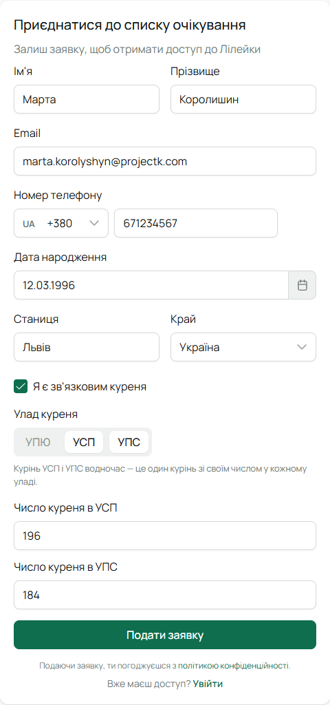
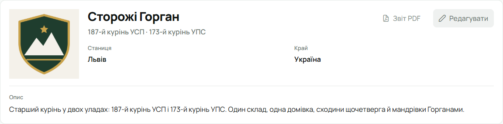
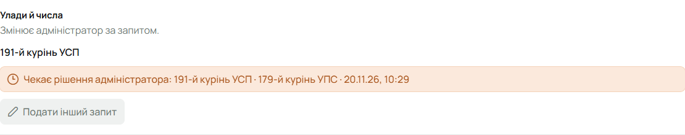
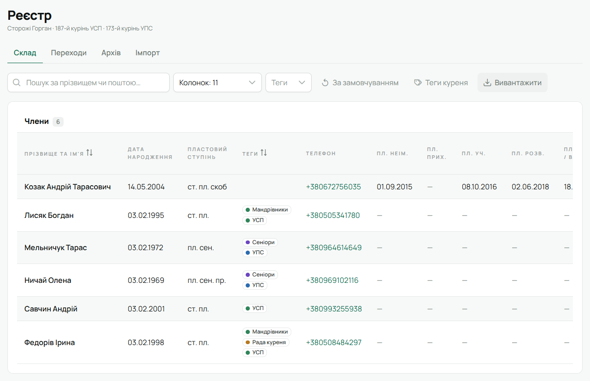

Старший курінь — це курінь **УСП**, **УПС** або обох уладів одразу. Курінь обох уладів у Лілейці
один, але в кожному уладі має своє число, наприклад «187-й курінь УСП · 173-й курінь УПС». Курінь
УПЮ старшим уладом бути не може.

У старшому курені немає гуртків. Усі люди в ньому, провід теж, — **члени куреня**. Групувати їх
можна [тегами](/user/features/tags/). Проб, вмілостей, модерації й відзначень УПЮ тут немає.
Календар, задачі, реєстр, вкладка, журнал і налаштування є, відмінності — в таблиці
[«Що де»](#що-де-упю-і-старший-курінь).

Улад кожної людини Лілейка визначає за її ступенями — [УПЮ, УСП, УПС](/user/features/branches/).

## Хто що може

| | Що робить у старшому курені |
|---|---|
| **Звʼязковий** | подає запит на улади й числа, дає ролям свої назви, завантажує емблему, змінює дані куреня й [налаштування](/user/features/kurin-settings/), заводить і ставить теги, приймає людей через [переходи](/user/howto/transfer-member/), підтверджує старші ступені, які людина вписала собі сама, поки була в УПЮ |
| **КВ** | бачить налаштування куреня — **«Лише перегляд»** |
| **Скарбник куреня** | веде [вкладку](/user/features/dues-senior/): рахунок кожного члена, ставки за тегами |
| **Член куреня** | свою картку, ступені й відзначення, свій рахунок у вкладці, календар і задачі — [Для члена старшого куреня](/user/roles/senior/) |
| **Адміністратор** | схвалює заявку на курінь і змінює улади й числа за запитом куреня |

Ролі курінь може назвати по-своєму — [«Назви ролей»](#назви-ролей).

## Заявка на курінь

Старший курінь відкривають так само, як курінь УПЮ, — заявкою на сторінці входу
([Перший вхід](/user/start/first-login/)). Різниця — у полі **«Улад куреня»**:

- обери **УСП**, **УПС** або обидва — тоді зʼявиться **«Число куреня в УСП»** і **«Число куреня в
  УПС»**, кожне своє;
- УПЮ разом зі старшим уладом обрати не можна: вибір УПЮ знімає УСП і УПС, і навпаки;
- **підготовчого** старшого куреня немає — прапорець «Мій курінь є підготовчим» є лише в УПЮ.

Заявку схвалює адміністратор. Хто подав заявку, стає **Звʼязковим** куреня.

## Сторінка куреня

Бічне меню → **«Курінь»**. Замість номерної таблички УПЮ тут **емблема** куреня, а заголовок — назва
куреня (поле «Імені / в честь кого») з уладами й числами під нею; без назви — самі улади й числа.
Плитки **«Гуртки»** немає: лишаються КВ, провід куреня й список людей.

**«Редагувати»** у Звʼязкового відкриває меню:

- **«Дані куреня»** — назва, станиця, край, опис;
- **«Завантажити емблему»** (PNG, JPEG чи WebP, з обрізанням), а коли вона вже є, — **«Замінити
  емблему»** і **«Прибрати емблему»**.

Поруч — **«Звіт PDF»**.

## Улади й числа

Свої улади й числа старший курінь сам не змінює: це робить адміністратор за запитом.
**«Налаштування»** → вкладка **«Курінь»** → блок **«Курінь»** → **«Улади й числа»**:

1. **«Подати запит»**.
2. Познач **УСП**, **УПС** або обидва й впиши **«Число в УСП»**, **«Число в УПС»**. Хоча б один
   улад має лишитися. Число не може бути зайняте іншим куренем краю.
3. За бажанням — **«Коментар для адміністратора (не обовʼязково)»**.
4. **«Надіслати запит»**.

Поки адміністратор не вирішив, у блоці видно **«Чекає рішення адміністратора: …»** з датою. Відкритий
запит у куреня один: **«Подати інший запит»** замінює попередній. Адміністраторам приходить
сповіщення **«Запит на улади й числа»** і лист; вони вирішують у [«Заявках»](/user/roles/admin/).
Тому, хто подав запит, приходить **«Улади й числа змінено»** або **«Запит на улади й числа
відхилено»**.

## Назви ролей

Старший курінь може назвати ролі по-своєму, наприклад писаря — скриптором. **«Налаштування»** →
**«Курінь»** → **«Назви ролей»**: біля кожної звичної назви — поле для своєї, до 60 знаків. Порожнє
поле лишає звичну назву.

Перейменувати можна ролі куреня: Звʼязковий, Курінний, Писар, Скарбник, Суддя, Хорунжий, Господар,
Хронікар, Інструктор, Впорядник, Інша курінна роль. Права ролі від назви не змінюються. Свої назви
видно на плитках КВ і проводу, на картці, у кнопці **«Передати роль: …»**, у журналі дій і
PDF-звіті. У куренях УПЮ цього блоку немає.

## Члени замість гуртків

Людей у старшому курені розрізняють теги: «УСП», «УПС», «провід», «кандидати» — як заведе курінь.
Теги тут **увімкнені** від початку (в УПЮ — вимкнені), їх заводять і ставлять у реєстрі —
[Теги куреня](/user/features/tags/).

- **Реєстр** — одна таблиця **«Члени»** замість «Юнаки» й «Впорядники», без колонки гуртка;
  остання таблиця — **«Чисельність за ступенями»** — [Реєстр](/user/features/registry/).
- **«Вивантажити»** зберігає Excel з аркушами **«Члени»** і **«Чисельність»**.
- **«Звіт PDF»** на сторінці куреня — улади й числа, члени й чисельність за ступенями, без гуртків
  і без окремої кадри виховників.
- **Вкладка** — рахунок кожного в касі куреня, ставки за тегами — [Вкладка старшого
  куреня](/user/features/dues-senior/).
- **Події й задачі** призначають куреню, людям (**«Люди куреня»**) або всім з тегом —
  [Календар і задачі](/user/features/calendar-and-tasks/).

## Хто може стати членом

- Старший курінь приймає людей **лише як членів** — вибору «Юнак / Впорядник» тут немає.
- Людина може бути членом **лише одного** старшого куреня. З іншого старшого куреня її можна тільки
  **«Перевести до нас»**.
- З куреня УПЮ — лише **«Прийняти ще й до нас»**: людина лишається у своєму курені УПЮ.
- Людину, яка ще в **УПЮ**, старший курінь не просить: Лілейка покаже **«Ще в УПЮ»**. Юнак куреня
  УПЮ без підтвердженого ступеня старшого пластуна чи сеніора — ще в УПЮ.

Хто відповідає на запит:

| Де людина зараз | Хто відповідає |
|---|---|
| член іншого старшого куреня | Звʼязковий того куреня |
| юнак куреня УПЮ | Звʼязковий того куреня |
| впорядник куреня УПЮ або ніде | сама людина, на сторінці **«Запрошення»** |
| ніде й без акаунта | ніхто: курінь приймає її одразу |

Покроково — [Перевести людину між куренями](/user/howto/transfer-member/#між-упю-і-старшим-куренем).
Член старшого куреня може бути ще й впорядником у курені УПЮ. Між куренями він перемикається
вгорі сторінки.

У [імпорті складу](/user/howto/import-roster/) старшого куреня немає колонки «Гурток». Рядок
людини, яка вже стоїть в іншому курені чи має акаунт, не імпортується — її запрошують через
«Переходи». Не імпортується й рядок людини, яка ще в УПЮ.

## Точкування

У старшому курені точкування **вимкнене** за замовчуванням: пункту в меню й плиток немає. Увімкнути
його можна в **«Налаштування»** → **«Можливості»** → **«Точкування»** — [Точкування](/user/features/score/).

## Що де: УПЮ і старший курінь

«—» — цього в курені немає.

| Сторінка чи функція | Курінь УПЮ | Старший курінь |
|---|---|---|
| [Заявка на курінь](/user/start/first-login/) | одне число або підготовчий курінь | УСП, УПС або обидва, у кожному своє число; підготовчого немає |
| Сторінка куреня | номерна табличка, плитка «Гуртки» | емблема, назва з уладами й числами; гуртків немає |
| Число куреня | змінює Звʼязковий сам — [Підготовчий курінь](/user/howto/preparatory-kurin/) | «Улади й числа» — лише запитом до адміністратора |
| [Назви ролей](#назви-ролей) | — | свої назви ролей куреня |
| Люди | юнаки й впорядники, гуртки | члени куреня, [теги](/user/features/tags/) |
| [Теги](/user/features/tags/) | вимкнені, вмикає курінь | увімкнені |
| [Реєстр](/user/features/registry/) | «Юнаки» й «Впорядники», колонка гуртка | одна таблиця «Члени» |
| Excel і «Звіт PDF» | гуртки, юнаки, кадра, чисельність | члени, чисельність, улади й числа |
| [Імпорт складу](/user/howto/import-roster/) | з колонкою «Гурток», може створити гуртки | без гуртка; хто стоїть деінде чи має акаунт — через «Переходи» |
| [Переходи](/user/howto/transfer-member/) | приймає юнаком чи впорядником | лише членом; з іншого старшого куреня — лише «Перевести»; з куреня УПЮ — лише «ще й до нас»; хто ще в УПЮ, того не просить |
| [Архів куреня](/user/features/archive/) | ролі, колишні членства, розформовані гуртки | ролі й колишні членства, без гуртків |
| [Картка людини](/user/features/member-card/) | проба, вмілості, відзначення УПЮ, впорядництво | плитки «‹назва куреня›» (у курені з, роль), «Відзначення», «Перестороги»; юнацьке — у [життєписі](/user/features/life-story/) |
| [Ступені](/user/features/branches/) | старший ступінь, вписаний собі, чекає Звʼязкового | людина в УСП чи УПС вписує наступні ступені сама, рахуються одразу |
| [Відзначення](/user/howto/skills-and-awards/) | УПЮ, з розглядом | УСП і УПС з переліку, без розгляду |
| [Проби й вмілості](/user/features/probes-and-badges/), [третя проба](/user/howto/third-probe/) | є | — |
| «Модерація вмілостей» | є | — |
| [Вкладка](/user/features/dues/) | каси гуртків і каса куреня | рахунок кожного в касі куреня, ставки за тегами — [окрема сторінка](/user/features/dues-senior/) |
| [Точкування](/user/features/score/) | увімкнене | вимкнене, можна ввімкнути |
| [Головна](/user/features/dashboard/) | плитки «Проба» й «Вмілості» | без них; «Точкування» — лише коли ведуть |
| [Календар і задачі](/user/features/calendar-and-tasks/) | курінь, гуртки, учасники, теги | курінь, «Люди куреня», теги |
| [Планування](/user/features/planning/) | КВ і виховники | КВ |
| [Налаштування куреня](/user/features/kurin-settings/) | «Число куреня», «Проба гуртків», «Картки до 18 років» | «Улади й числа», «Назви ролей»; без проби й карток до 18 |
| [Права й видимість](/user/howto/access-policy/) | усі групи | без «Проби й вмілості»; «Особисті дані» замість «Дані юнаків», «Члени куреня» замість «Юнаки» |
| [Журнал дій](/user/features/journal/) | так | так само |
| [Сповіщення](/user/features/notifications/) | — | «Запит на улади й числа», «Улади й числа змінено» |
| [На телефоні](/user/features/mobile-app/) | «Вкладка гуртка», «Вкладка куреня», «Модерація вмілостей» | «Вкладка куреня» відкривається у вебі; модерації немає |

## На телефоні

Застосунок на телефоні показує старший курінь так само: курінь, календар, задачі, своя картка.
Касу старшого куреня — пункт **«Вкладка куреня»** — і **«Налаштування куреня»** телефон відкриває у
браузері. Пункту «Модерація вмілостей» у старшому курені немає.
