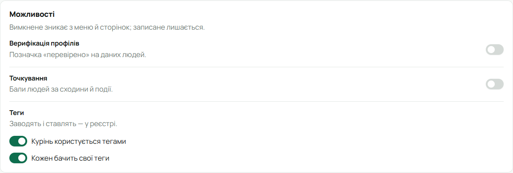
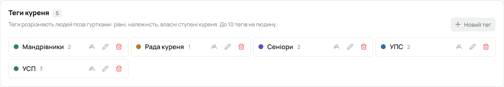
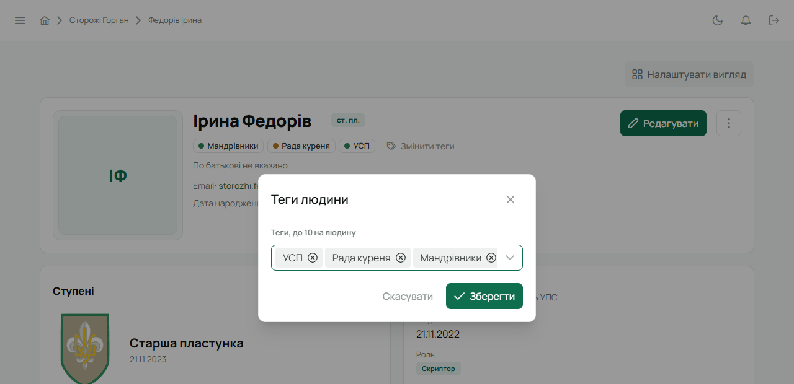
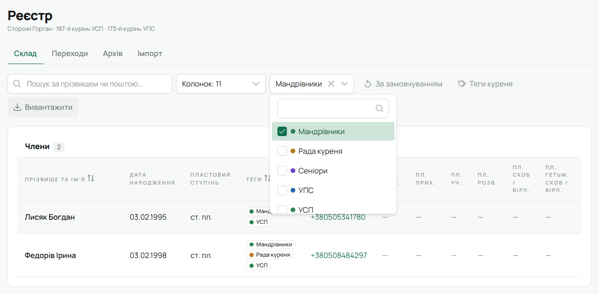
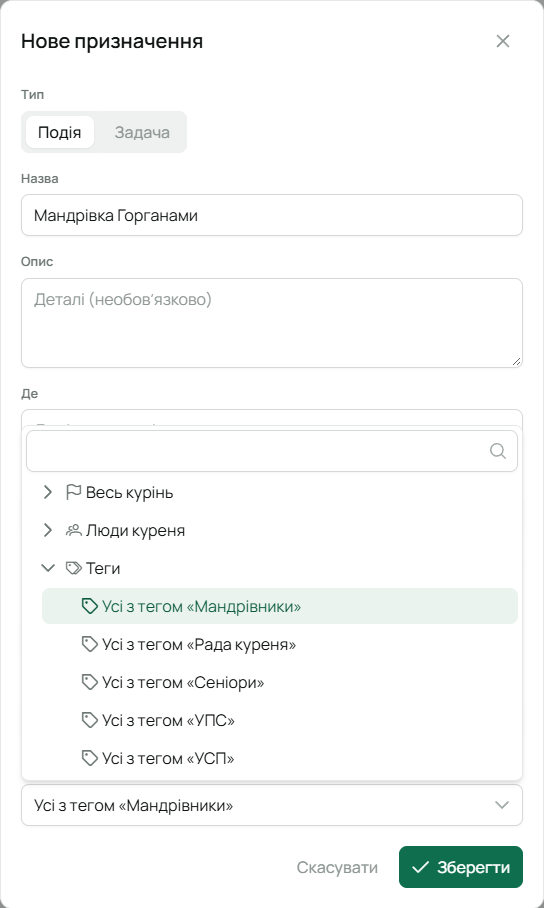

Тег — мітка на людині, яку курінь заводить сам, наприклад «УСП», «кандидати», «провід». У старшому
курені теги заміняють гуртки, в УПЮ — доповнюють їх. Кожен тег має
назву й колір; у людини може бути до **10** тегів у курені.

## Хто що може

Три права на теги задають у [правах і видимості куреня](/user/howto/access-policy/): перші два — у
групі **«Теги»**, третє — у групі **«Події й задачі»**.

| Право | За замовчуванням | Що можна поставити |
|---|---|---|
| **«Бачити теги людей»** | Звʼязковий, впорядники, інструктори, курінний, провід куреня — увесь курінь; гуртковий і провід гуртка — свій гурток; юнаки — ні | «—», «Свій гурток» чи «Увесь курінь»; можна відкрити й юнакам |
| **«Заводити теги й ставити їх людям»** | Звʼязковий | «—» чи «Увесь курінь» |
| **«Призначати всім з тегом»** | Звʼязковий, курінний, провід куреня | «—» чи «Увесь курінь» |

Звʼязковий має всі три права завжди. Хто може ставити теги, той бачить їх на всіх. Коли ввімкнено
**«Кожен бачить свої теги»** (див. нижче), людина бачить свої теги незалежно від права «Бачити
теги людей». Вмикає й вимикає теги Звʼязковий у [налаштуваннях куреня](/user/features/kurin-settings/).

## Увімкнути теги

**«Налаштування»** → вкладка **«Курінь»** → блок **«Можливості»** → **«Теги»**:

- **«Курінь користується тегами»** — головний перемикач. В УПЮ за замовчуванням вимкнено, у
  старшому курені (УСП, УПС) — увімкнено.
- **«Кожен бачить свої теги»** — зʼявляється, коли теги ввімкнено. За замовчуванням увімкнено.

Збережи панеллю **«Зберегти»** внизу сторінки.

Вимкнені теги зникають з реєстру, карток, звітів і вибору в подіях, але не стираються: увімкнеш
знову — усе на місці. Поки теги вимкнено, завести чи поставити новий не вийде: «Теги в курені
вимкнені. Їх вмикають у налаштуваннях куреня.»

## Завести, змінити, видалити

**«Реєстр»** → вкладка **«Склад»** → кнопка **«Теги куреня»** над таблицею. Кнопку бачить лише
той, хто має право «Заводити теги й ставити їх людям». Відкривається панель зі списком тегів і
числом людей біля кожного.

- **«Новий тег»** — поле **«Назва»** (до 40 знаків, у курені не повторюється) і **«Колір»** — один
  із семи: зелений, синій, охра, вишневий, фіолетовий, бірюзовий, сірий.
- Олівець — **«Змінити тег»**: нова назва чи колір. На людях тег лишається.
- Значок людей — **«Хто має тег «…»»**: у полі **«Люди куреня»** познач усіх, хто має його носити, і
  збережи. Кого вибрати не можна, той уже має 10 тегів.
- Кошик — **«Видалити тег?»**. Тег зникає з усіх, хто його мав.

:::caution
Видалений тег не повернути. Разом із ним зникає ціль «Усі з тегом» у подіях і задачах (сама подія
лишається), а в старшому курені несплачені квартали людей переходять на ставку, яку дають їхні
теги тепер.
:::

Тег можна поставити лише тому, хто зараз у курені. Хто вийшов, зберігає свої теги на випадок
повернення.

## На картці людини

Теги видно в шапці [картки](/user/features/member-card/), під іменем, — ті, які ти маєш право
бачити. Хто може ставити теги, бачить тут **«Змінити теги»**: у вікні **«Теги людини»** обираєш до
10 тегів куреня. Якщо тегів ще немає: «У курені ще немає тегів. Заведи їх у реєстрі, кнопкою
«Теги куреня».»

Теги належать куреню. Людина в кількох куренях має в кожному курені свої теги. Ставлять їх у
курені, вибраному вгорі сторінки.

## У реєстрі, Excel і PDF

- Колонка **«Теги»** є в [реєстрі](/user/features/registry/) за замовчуванням; її можна прибрати в
  **«Колонки»** і сортувати за нею.
- Фільтр **«Теги»** поруч з колонками лишає людей, які мають хоч один з обраних тегів. Зʼявляється,
  коли в курені є теги.
- Пошук знаходить людей і за назвою тегу.
- **«Вивантажити»** кладе колонку «Теги» в Excel, якщо вона на екрані. Пошук і фільтр на файл не
  впливають: у ньому весь склад.
- **«Звіт PDF»** на сторінці куреня друкує теги людей, чиї теги ти бачиш.

## Події й задачі для всіх з тегом

У новій [події](/user/howto/create-event/) чи [задачі](/user/howto/create-task/) в полі **«Призначити для»**
є розділ **«Теги»** з рядками **«Усі з тегом «…»»**. Така подія чи задача — для кожного, хто має тег
зараз або дістане його пізніше. Розділ бачить той, хто має право «Призначати всім з тегом», і лише
поки курінь користується тегами. Якщо теги вимкнути, уже призначені тегу події лишаються.

## Вкладка в старшому курені

У старшому курені теги визначають членську вкладку. У **«Ставках куреня»** поле **«Для кого»**
пропонує теги й **«Усім іншим»**; людина з кількома тегами платить найвищу зі ставок своїх тегів.
Реєстр рахунків показує теги людей і фільтрує за ними. Детально —
[Вкладка старшого куреня](/user/features/dues-senior/).

## Журнал дій

У [журналі дій](/user/features/journal/) теги мають свій фільтр **«Теги»**. Туди лягає:

- **«Заведено тег»**, **«Змінено тег»** (назва, колір), **«Видалено тег»** — з числом людей, які його
  мали;
- **«Поставлено тег»** і **«Знято тег»** — окремим записом про кожну людину;
- **«Змінено налаштування тегів»** — перемикачі з «Можливостей».

Зміни трьох прав на теги лягають як **«Змінено права й видимість»**.

## На телефоні

У застосунку теги видно на картці людини, а в новій події чи задачі є **«Усі з тегом «…»»**.
Заводити теги й ставити їх людям — у вебверсії: пункт «Реєстр» відкриває її в браузері.
