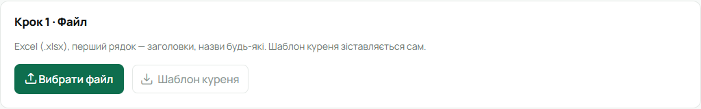
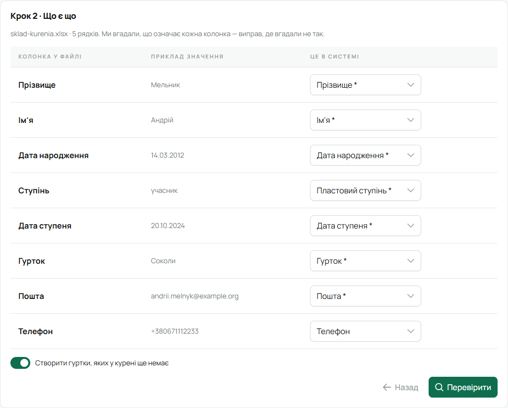
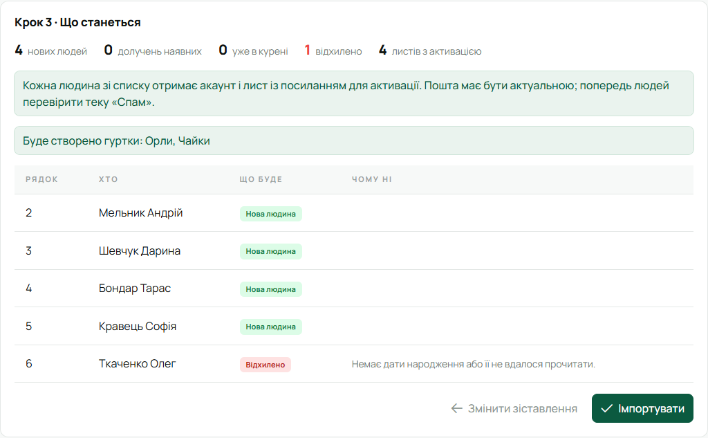

Щоб не вносити людей по одному, завантаж таблицю Excel зі складом куреня. Лілейка спершу покаже, що
станеться з кожним рядком, і нічого не запише, поки ти не натиснеш **«Імпортувати»**.

Імпортує Звʼязковий (і адміністратор): бічне меню → **«Реєстр»** → вкладка **«Імпорт»**.

## Що має бути в таблиці

Файл `.xlsx` з одним аркушем, перший рядок — заголовки, далі рядок на людину. Обовʼязкові колонки:

- прізвище, імʼя, дата народження;
- пластовий ступінь і дата ступеня;
- гурток (лише в курені УПЮ);
- пошта: без неї людині не відкрити акаунт.

Необовʼязкові: по батькові, телефон, курінь, дати окремих ступенів.

Найпростіше — почати з **«Шаблону куреня»**: у ньому вже є потрібні колонки, і їх не треба
зіставляти.

## Крок 1 · Файл

1. Натисни **«Шаблон куреня»**, щоб завантажити порожню таблицю, і заповни її. Свою таблицю можна
   брати як є: назви колонок будь-які.
2. Натисни **«Вибрати файл»** і вибери таблицю.

Якщо файл не читається, Лілейка скаже: «Не вдалося прочитати файл. Це має бути .xlsx з одним
аркушем.»

## Крок 2 · Що є що

Лілейка вгадує, що означає кожна колонка. Таблиця: **«Колонка у файлі»**, **«Приклад значення»**
(перше значення з неї) і **«Це в системі»**.

1. Пройдись по колонці **«Це в системі»** й виправ, де вгадано не так. Обовʼязкові поля позначено
   зірочкою, дати окремих ступенів — пункти «Дата: …». Колонку, яка не потрібна, постав на
   **«Не імпортувати»**.
2. Поки якогось обовʼязкового поля немає, вгорі видно **«Ще не вказано: …»**, і перейти далі не вийде.
3. У курені УПЮ: якщо у файлі є гуртки, яких у курені ще немає, увімкни **«Створити гуртки, яких у
   курені ще немає»**. Без цього такі рядки буде відхилено.
4. Натисни **«Перевірити»**.

## Крок 3 · Що станеться

Це перевірка: ще нічого не записано. Угорі підсумки:

| Підсумок | Що означає |
|---|---|
| **нових людей** | Лілейка цих людей не знає, буде заведено новий запис |
| **долучень наявних** | людина вже є в Лілейці, її буде прийнято в курінь без дубля |
| **уже в курені** | людина вже у твоєму курені, нічого не зміниться |
| **відхилено** | рядок не пройде, причина — в колонці «Чому ні» |
| **листів з активацією** | стільки людей дістануть акаунт і лист із посиланням для активації |

Людину вважають знайомою, якщо збігається пошта, або телефон, або прізвище, імʼя й дата народження
разом.

Під підсумками можуть бути:

- **«Буде створено гуртки: …»** — якщо ти ввімкнув створення гуртків;
- **«Рядки, де вказано інший курінь: …»** — колонка «Курінь» лише попереджає: усіх імпортують у твій
  курінь.

Нижче таблиця рядків: **Рядок · Хто · Що буде · Чому ні**, у «Що буде» — «Нова людина», «Долучено
наявну», «Уже в курені» чи «Відхилено». Номер рядка — такий, як в Excel.

Щось не так — **«Змінити зіставлення»** поверне на крок 2. Усе гаразд — натисни **«Імпортувати»**.

:::caution
Після **«Імпортувати»** листи з активацією підуть одразу. Перевір пошту в таблиці й попередь людей
заглянути в теку «Спам».
:::

## Результат

Зʼявиться **«Готово»**: скільки людей заведено й скільки наявних долучено. Відхилені рядки можна
виправити у файлі й імпортувати ще раз: наявні записи від цього не подвояться. **«До складу»**
відкриває вкладку «Склад», **«Імпортувати ще файл»** — крок 1.

Якщо на запису щось пішло не так, нічого не записується: «Імпорт не пройшов. Нічого не записано.»
Біля рядка, де акаунт відкрито, а лист не пішов, про це написано в «Чому ні»: надішли лист з картки
людини, див. [Надіслати запрошення ще раз](/user/howto/membership/#надіслати-запрошення-ще-раз).

## УПЮ і старший курінь

| | Курінь УПЮ | Старший курінь |
|---|---|---|
| Гурток | обовʼязковий, кожного кладе в гурток | гуртків немає, колонку «Гурток» не беруть |
| «Створити гуртки…» | є | немає |
| Людина, яку Лілейка вже знає | долучає до куреня; де вона вже стоїть, там і лишається | бере, лише якщо людина ніде не стоїть і не має акаунта |

У старшому курені рядок людини, яка вже десь стоїть чи має акаунт, відхилено з причиною «Людина
вже є в Лілейці…». Таку людину запрошують через [переходи](/user/howto/transfer-member/). Людину,
яка ще в УПЮ, старший курінь не бере: «Людина ще в УПЮ.»

## На телефоні

Імпорту на телефоні немає: «Реєстр» у меню відкриває повну версію в браузері.
