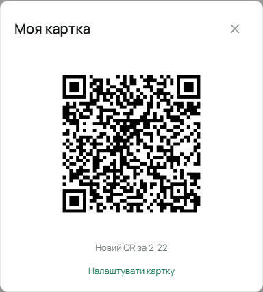
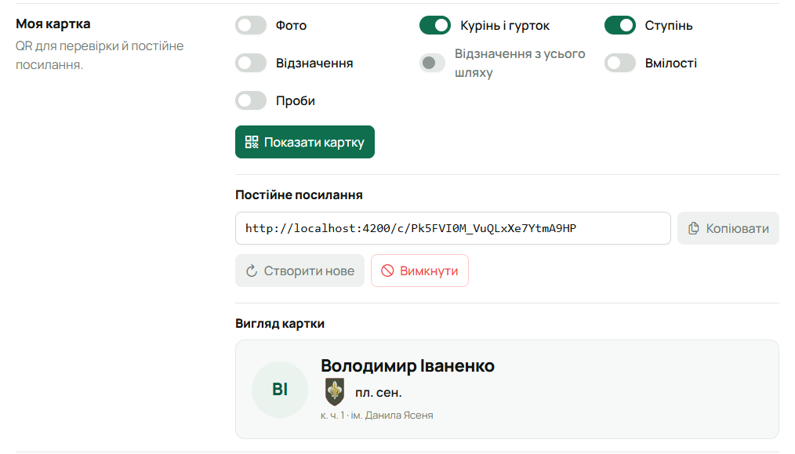
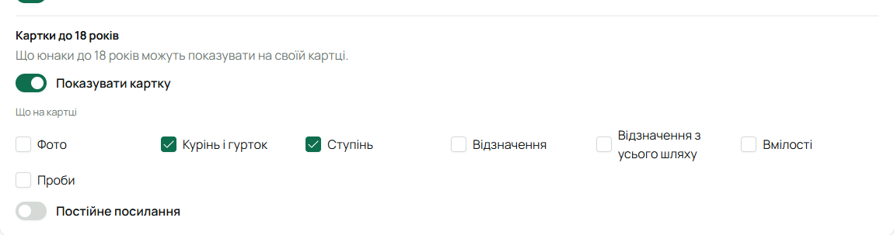
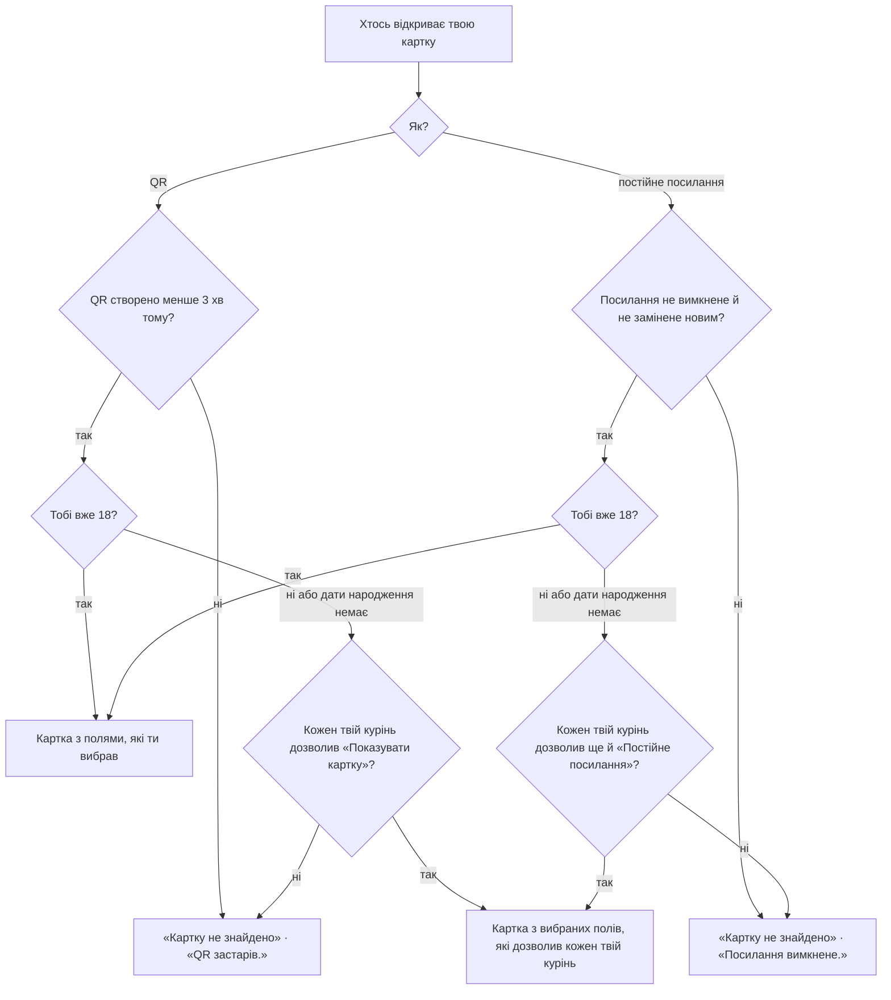
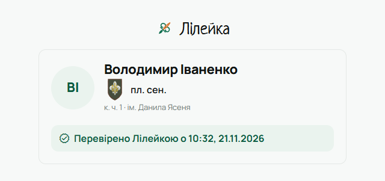
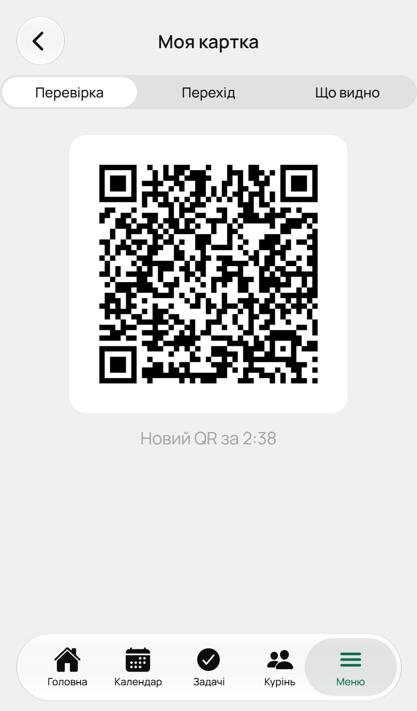

Твоя картка (імʼя, курінь, ступінь, відзначення) може відкритись у будь-кого, навіть без
акаунта в Лілейці. Показати її можна двома способами:

- **QR** — щоб показати на місці: на таборі, на вишколі, на зустрічі. Кожен QR діє 3 хвилини:
  знімок екрана з ним потім нічого не відкриє.
- **Постійне посилання** — щоб покласти картку в резюме, анкету чи лист. Діє, поки ти його не
  вимкнеш або не створиш нове.

Показати картку може кожен, хто має акаунт. Кому вже є 18, налаштовує все сам. До 18 — лише те,
що дозволив курінь, див. [До 18 років](#до-18-років).

## Показати картку (QR)

1. Унизу бічного меню натисни на свою пошту — відкриється [меню акаунта](/user/howto/switch-account/).
2. Натисни **«Показати картку»**.

   

3. Дай відсканувати QR камерою телефону. Під ним видно **«Новий QR за …»**: незадовго до кінця
   QR змінюється сам, тож вікно можна тримати відкритим скільки треба.

Хто сканував, бачить твою картку на сторінці Лілейки, а внизу — **«Перевірено Лілейкою о …»** з
часом і датою. Якщо відкрити ту саму адресу пізніше, буде **«Картку не знайдено»** і
**«QR застарів.»**

Якщо курінь не дозволяє тобі показувати картку, у вікні буде **«Курінь ще не дозволив показувати
картку.»** Посилання **«Налаштувати картку»** внизу вікна веде до налаштувань нижче.

## Вибрати, що на картці

**«Налаштування»** → вкладка **«Акаунт»** → розділ **«Моя картка»**.

Імʼя видно завжди. Решту вмикаєш сам:

| Перемикач | Що показує |
|---|---|
| **«Фото»** | фото профілю; без нього — ініціали |
| **«Курінь і гурток»** | курені, де ти зараз, і гурток |
| **«Ступінь»** | теперішній ступінь з рисунком |
| **«Відзначення»** | підтверджені відзначення того уладу, де ти зараз: юнакові — УПЮ, у старшому курені — УСП/УПС |
| **«Відзначення з усього шляху»** | відзначення УПЮ, УСП й УПС разом, кожен улад окремо; вмикається лише разом з «Відзначеннями» |
| **«Вмілості»** | підтверджені вмілості |
| **«Проби»** | закриті й підтверджені проби |

Спочатку ввімкнено лише курінь і ступінь. Перемикач зберігається одразу. Нижче —
**«Вигляд картки»**: картка такою, як її побачать інші.

Що курінь не дозволяє, вимкнене й не перемикається. Твій вибір при цьому лишається: коли курінь
дозволить більше або тобі виповниться 18, картка покаже й те, що ти вмикав раніше.

## Постійне посилання

У тому самому розділі, під перемикачами, — **«Постійне посилання»**.

1. Натисни **«Створити посилання»**. Зʼявиться поле з адресою.
2. **«Копіювати»** — адреса в буфері, Лілейка скаже **«Посилання скопійовано»**.

Посилання показує картку з тими самими полями, що й QR, але без рядка «Перевірено Лілейкою».

- **«Створити нове»** — нова адреса замість старої. Лілейка спитає **«Створити нове посилання?»**:
  стара адреса одразу перестане працювати.
- **«Вимкнути»** — посилання перестає працювати. Лілейка спитає **«Вимкнути посилання?»**

:::caution
Нове посилання й вимкнення не скасувати: хто мав стару адресу, побачить **«Картку не знайдено»** і
**«Посилання вимкнене.»** Щоб поділитися знову, створи посилання й надішли його ще раз.
:::

## До 18 років

Поки тобі немає 18, картку показують лише тоді, коли дозволив **кожен** курінь, де ти зараз.
Курінь вирішує, що саме можна показати й чи можна постійне посилання. Якщо в Лілейці не вказано
дату народження, Лілейка теж вважає, що 18 ще немає.

Правило ставить той, хто змінює [налаштування куреня](/user/features/kurin-settings/):

1. **«Налаштування»** → вкладка **«Курінь»** → блок **«Картка людини»** → **«Картки до 18 років»**.
2. Увімкни **«Показувати картку»**.
3. У **«Що на картці»** познач, що можна показувати: ті самі пункти, що в «Моїй картці».
4. За потреби увімкни **«Постійне посилання»** (є лише разом з «Показувати картку»).
5. Натисни **«Зберегти»** на панелі внизу.

Поки курінь цього не налаштував, юнаки картку не показують. Блок «Картки до 18 років» є лише в
курені УПЮ. Правило діє одразу: якщо курінь його вимкне, QR і посилання юнака показуватимуть
«Картку не знайдено».

Кому вже є 18, правило куреня не стосується: показує все, що вибрав сам.

## Хто бачить картку

Кожне відкриття QR чи посилання Лілейка перевіряє наново: вік, правило кожного куреня, твій вибір
полів.

Юнак, який зараз не стоїть у жодному курені, картку не показує.

## Що бачить той, хто відкрив

Сторінку Лілейки з карткою: імʼя, фото чи ініціали, ступінь, рядок з куренем і гуртком, далі
розділи **«Відзначення»**, **«Вмілості»**, **«Проби»** — лише ті, що ти ввімкнув. Порожній
розділ каже **«Ще немає.»** Ні контактів, ні дати народження, ні адреси картка не показує ніколи.
Пошуковики таку сторінку не індексують.

## На телефоні

**«Меню»** → **«Показати картку»** відкриває сторінку **«Моя картка»** з трьома вкладками:

- **«Перевірка»** — той самий QR, що міняється сам, і **«Новий QR за …»**.
- **«Перехід»** — твій код для переходу в інший курінь, див.
  [Перевести людину між куренями](/user/howto/transfer-member/).
- **«Що видно»** — ті самі перемикачі й **«Постійне посилання»**: **«Створити посилання»**,
  **«Поділитися посиланням»** (відкриває меню «Поділитися» телефону) і **«Вимкнути»**. Нової
  адреси замість старої на телефоні не створити: для цього є веб.

**«Меню»** → **«Сканувати QR»** вмикає камеру. Телефон спитає дозволу на неї; без дозволу буде
**«Немає доступу до камери.»** Що вийде після сканування:

- QR картки чи постійне посилання — відкриється картка;
- код для переходу — відкриються **«Переходи»** з цим кодом (для Звʼязкового);
- будь-що інше — **«Це не посилання Лілейки»**, текст із QR і **«Сканувати ще раз»**.

Сканувати картку можна й звичайною камерою телефону: QR — це адреса сторінки.
