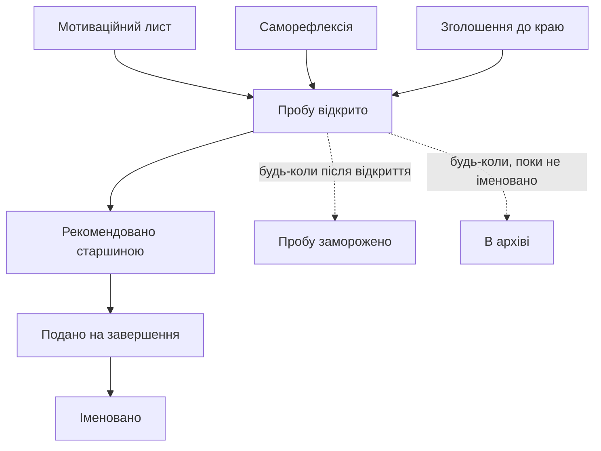
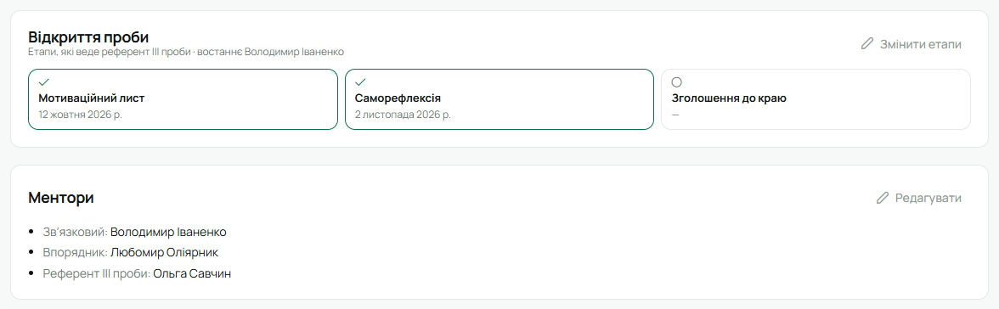
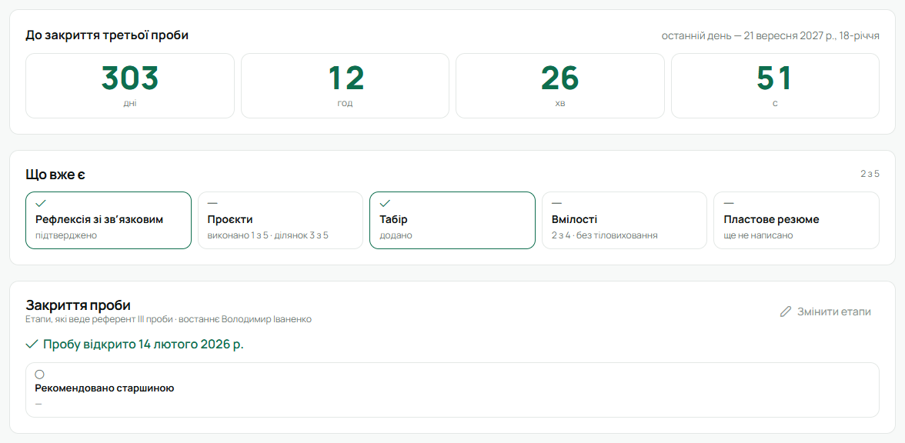
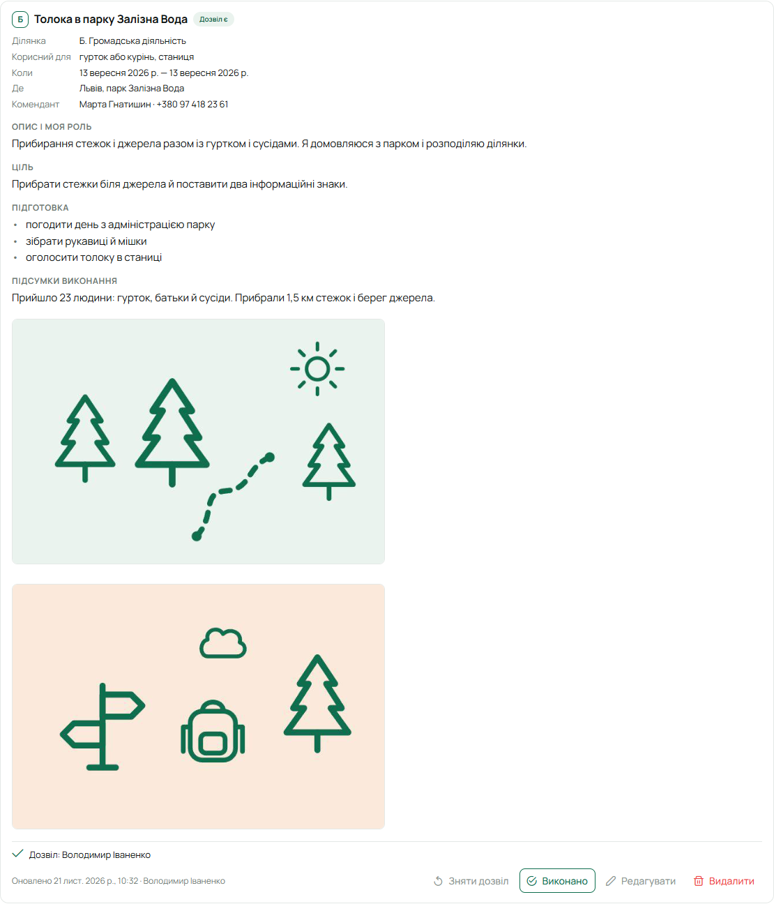
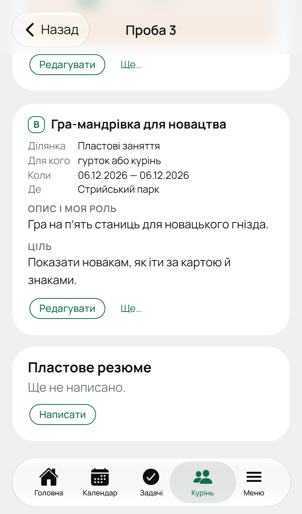

Третя проба не ділиться на точки: вона складається з проєктів, табору, вмілостей і резюме, а її
сторінка повторює файл третьопробника. Відкривається на картці, коли закрито другу пробу.

Де знайти: картка юнака → плитка **«Проба»** → рядок третьої проби → **«Деталі»**. Поки друга
проба не закрита, у рядку написано **«Відкриється після закриття: …»**, а «Деталі» неактивні.

## Хто що робить

| | Юнак | Хто підписує пробу |
|---|:-:|:-:|
| вписати менторів, рефлексію, табір, посвідку | ✓ | ✓ |
| позначити вмілість «Це тіловиховання» | ✓ | ✓ |
| писати проєкти, міняти запасний, видаляти | ✓ | ✓ |
| писати пластове резюме | ✓ | ✓ |
| підтвердити рефлексію | | ✓ |
| дати дозвіл на проєкт, позначити виконаним | | ✓ |
| змінити етапи | | ✓ |

Хто підписує пробу, вирішує курінь у [Правах і видимості](/user/howto/access-policy/); за
замовчуванням це впорядник гуртка юнака й Звʼязковий. Зняти підтвердження, дозвіл чи «виконано»
може той, кому дозволено знімати підписи. **Власну пробу не підписує ніхто**: впорядник, який сам
іде третьою пробою, пише свою сторінку, як юнак, але не підтверджує в ній нічого.

Окремої ролі референта ІІІ проби в Лілейці немає: його імʼя вписують у «Менторах», а етапи вносить
той, хто підписує пробу.

## Етапи

Етапи — це дні, коли щось сталося. Їх ставить той, хто підписує пробу, кнопкою **«Змінити етапи»**
(вікно **«Етапи проби»**). Порожнє поле — етапу ще не було; очистити дату можна хрестиком.

- **Відкриття**: **«Мотиваційний лист»** (план здачі проби; пише 15-річний), **«Саморефлексія»**,
  **«Зголошення до краю»**, **«Пробу відкрито»**. Перші три — у будь-якому порядку й необовʼязкові:
  16-річний, наприклад, мотиваційного листа не пише.
- **Закриття** — суворо по черзі й не раніше за попередній: **«Рекомендовано старшиною»** після
  відкриття, **«Подано на завершення»** після рекомендації, **«Іменовано»** після подання.
- **«Якщо проба зупинилась»** — два окремі стани: **«Пробу заморожено»** (не раніше дня
  відкриття) і **«В архіві»** (проба, що не дійшла до іменування; іменовану не архівують).

Якщо порядок порушено, Лілейка не збереже й скаже: «Етапи не по черзі: …». На сторінці видно
пройдені етапи поточної частини (відкриття чи закриття) і наступний; заморозка й архів —
лише коли вони настали.

## До відкриття

Поки не стоїть **«Пробу відкрито»**, на сторінці лише етапи відкриття й **«Ментори»**.

1. На плитці **«Ментори»** натисни **«Редагувати»**.
2. У вікні **«Ментори»** заповни **«Звʼязковий»** і **«Впорядник»** — обери зі списку (Звʼязкові
   куреня; впорядники куреня, свого гуртка першими) або впиши імʼя — і **«Референт ІІІ проби»**.
3. **«Зберегти»**.
4. Той, хто підписує пробу, натискає **«Змінити етапи»** і ставить дати етапів відкриття, коли вони
   стаються. Останнім — **«Пробу відкрито»**.

Щойно стоїть «Пробу відкрито», сторінка розгортається повністю, а під етапами зʼявляється
**«Пробу відкрито ‹дата›»**.

## Після відкриття

### Відлік і «Що вже є»

**«До закриття третьої проби»** — скільки лишилось днів, годин, хвилин і секунд до останнього дня,
18-річчя. Відлік бачать ті, кому курінь показує дату народження. Коли день минув — **«Строк третьої
проби минув»**.

**«Що вже є»** — пʼять вимог, кожна з позначкою, чи виконано:

| Вимога | Виконано, коли |
|---|---|
| **«Рефлексія зі звʼязковим»** | рефлексію підтверджено |
| **«Проєкти»** | пʼять основних виконано й покрито всі пʼять ділянок |
| **«Табір»** | табір вказано |
| **«Вмілості»** | чотири вмілості від відкриття, одна з них — тіловиховання |
| **«Пластове резюме»** | резюме написано |

### Рефлексія й табір

1. На плитці **«Ментори й рефлексія»** чи **«Табір»** натисни **«Редагувати»** — відкриється вікно
   **«Ментори, рефлексія й табір»**.
2. **«Рефлексія відбулася»** — дата; **«З ким»** — Звʼязковий зі списку або впиши сам. Тема —
   «Що для мене означає бути пластуном».
3. **«Табір»** — **«КВТ»** чи **«Альтернативний табір»**; **«Назва табору»**, **«Від»**, **«До»**.
   КВТ досить і без назви, альтернативний табір рахується вказаним лише з назвою.
4. **«Зберегти»**.
5. Той, хто підписує пробу, натискає **«Підтвердити рефлексію»** (кнопка зʼявляється, щойно є
   дата). Під рефлексією стане **«Підтвердив ‹імʼя›»**.

Якщо потім змінити дату чи співрозмовника рефлексії, її підтвердження знімається. Табір Лілейка
не підтверджує: його зараховує край.

Під рефлексією — **«Діловодства під час проби»**: ролі в курені, які юнак мав від дня відкриття.
Вони беруться з ролей куреня, див. [Записати провід](/user/howto/assign-leadership/).

### Посвідка табору

На плитці **«Табір»** — **«Прикріпити посвідку»**: фото чи скан (PNG, JPEG, WebP) або PDF, до
2 МБ. Потім — **«Замінити посвідку»** і **«Прибрати»**. Під ними видно, скільки місця вже займають
файли: **«Файли третьої проби: … з 10 МБ»**.

### Вмілості

Плитка **«Вмілості»** показує підтверджені вмілості, здобуті від дня відкриття, і лічильник
**«під час проби … з 4, одна — з тіловиховання»**. Біля вмілості з фізичної вправности чи
тіловиховання натисни **«Це тіловиховання»** — вона дістане позначку **«Тіловиховання»**.
Вмілості, здобуті раніше, — під кнопкою **«Усі вмілості юнацтва (…)»**. Як здобути вмілість —
[Вмілості й відзначення](/user/howto/skills-and-awards/).

### Проєкти

Пʼять основних проєктів, по одному з кожної ділянки, і один запасний:

- **А.** Пластова присяга, ідея та організація
- **Б.** Громадська діяльність
- **В.** Пластові заняття
- **Г.** Життя в природі
- **Ґ.** Провідництво

Літери під заголовком «Проєкти» підсвічуються, коли ділянку вже покрито; поруч — скільки
основних і скільки спільних.

1. Натисни **«Додати проєкт»** (коли пʼять основних уже є — **«Додати запасний»**).
2. Заповни: **«Назва проєкту»**, **«Тематика (ділянка)»**, **«Реалізується на рівні та корисний
   для»** (гурток або курінь, станиця, українська громада, ширша громада), **«Дата початку»** і
   **«Дата закінчення»**, **«Локація»**, **«Комендант»** і **«Контакт коменданта»**. Комендант —
   повнолітній, може бути й не пластун: тренер, майстер, учитель.
3. Якщо проєкт спільний з іншими третьопробниками, познач **«Спільний з іншими третьопробниками»**
   і впиши **«З ким»**. Спільних серед основних — не більше двох.
4. Чотири тексти: **«Опис і моя роль»**, **«Ціль»**, **«Підготовка»**, **«Підсумки виконання»** —
   кожен до 10 000 знаків. Підсумки й фото можна дописати пізніше.
5. **«Зберегти»**.

Далі той, хто підписує пробу:

- **«Дати дозвіл»** — проєкт можна робити; на картці проєкту **«Дозвіл є»** і **«Дозвіл: ‹імʼя›»**.
- **«Виконано»** — вікно **«Проєкт виконано»**: перепиши **«Коментар коменданта»**, якщо він його
  дав, і **«Позначити виконаним»**. На проєкті — **«Виконано»**, **«Успішно виконано: ‹імʼя›»** і
  коментар.

Зняти їх — **«Зняти дозвіл»** і **«Зняти «виконано»»**.

**Запасний проєкт** розписують наперед. Якщо основний не вдасться, на запасному натисни
**«Поставити замість…»**, обери основний і **«Поміняти»**: запасний стане основним, а обраний —
запасним. Тексти й фото обох лишаються.

:::caution
**«Видалити»** прибирає проєкт разом з текстами й фото — повернути його не вийде. Місце видаленого
основного займе запасний. Якщо запасний спільний, а серед основних уже два спільні, він лишиться
запасним.
:::

### Фото

Фото вставляють у тексти проєкту: кнопкою зображення на панелі редактора, вставкою з буфера
(Ctrl+V) чи перетягуванням.

- до 5 фото на проєкт, кожне до 1 МБ, PNG, JPEG або WebP;
- усі файли третьої проби разом — фото й посвідка — не більше 10 МБ. Межу написано під
  редактором проєкту.

Більший файл чи не зображення Лілейка не прийме й скаже чому: «Зображення завелике.», «Файли
третьої проби вже займають майже все місце (до 10 МБ). Прибери зайві фото.» Фото, яке прибрали з
тексту, видаляється, щойно проєкт збережено.

### Пластове резюме

На плитці **«Пластове резюме»** — **«Написати»** (потім **«Редагувати»**): коли вступив до
Пласту, які проби, табори, вмілості й ролі мав, чим живеш поза Пластом. Можна заголовки, жирний,
курсив, списки й посилання, до 10 000 знаків; зображень у резюме немає.

## Закриття

Коли все готово, той, хто підписує пробу, ставить у **«Змінити етапи»** етапи закриття в тій
черзі, у якій вони стаються: **«Рекомендовано старшиною»** → **«Подано на завершення»** →
**«Іменовано»**. Якщо проба зупинилась — **«Пробу заморожено»** чи **«В архіві»**.

Усе, що робиться з третьою пробою, — запис, підтвердження, дозволи, етапи, проєкти й фото —
лягає в [Журнал дій](/user/features/journal/) куреня.

## На телефоні

Картка юнака → **«Проба»** → третя проба. Видно все: відлік, «Що вже є», етапи, менторів і
рефлексію, табір, вмілості, проєкти й резюме, і писати можна там само:

- **«Редагувати»** відкриває менторів, рефлексію, табір і резюме; **«Прикріпити посвідку»** — поруч;
- **«Змінити етапи»**, **«Підтвердити рефлексію»** чи **«Зняти підтвердження»** — для того, хто
  підписує пробу;
- біля вмілості — **«Тіловиховання»**;
- **«Додати проєкт»** (**«Додати запасний проєкт»**), фото — з галереї телефону;
- решта дій з проєктом — під **«Ще…»**: **«Дати дозвіл»**, **«Позначити виконаним»**, **«Зняти
  дозвіл»**, **«Зняти «виконано»»**, **«Поставити замість основного…»**, **«Видалити проєкт»**.

## У старшому курені

Проб у старшому курені немає. Третя проба старшого пластуна лишається в його
[життєписі](/user/features/life-story/) як архів юнацтва: сторінка проби каже **«Архів юнацтва ·
тільки перегляд»**, і нічого в ній не змінити.
