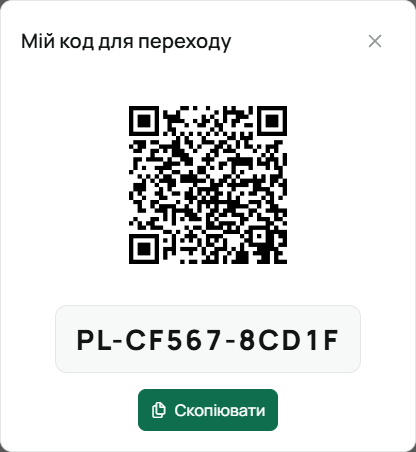
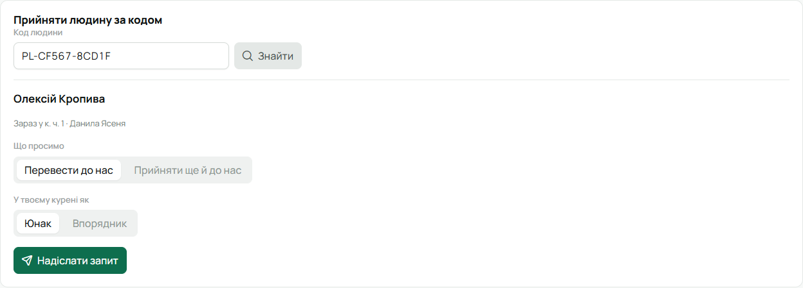
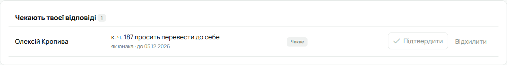
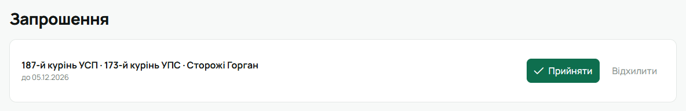
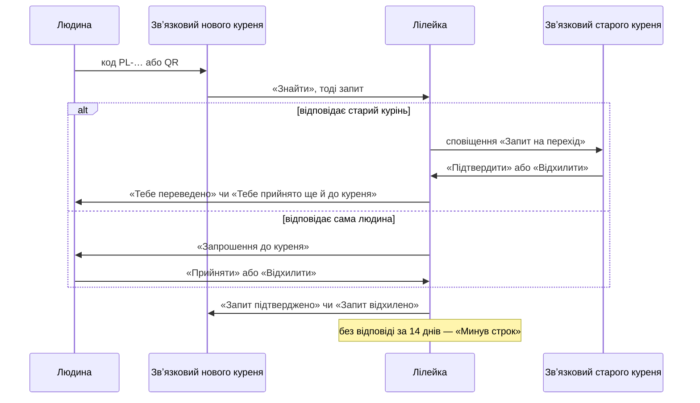

Жоден курінь не забирає людину сам. Звʼязковий куреня, куди вона йде, надсилає запит, а відповідає
Звʼязковий куреня, де вона зараз, або сама людина. Просити можна двох речей:

- **«Перевести до нас»** — членство в старому курені закривається, у новому відкривається;
- **«Прийняти ще й до нас»** — людина лишається в старому курені й стає ще й членом нового.

Членом можна бути лише одного старшого куреня, тож між старшими куренями людину лише переводять.

Проби, вмілості, відзначення й ступені завжди лишаються з людиною, хоч би куди вона перейшла.

| Хто | Що робить |
|---|---|
| Людина | показує свій код чи QR, відповідає на запрошення |
| Звʼязковий нового куреня | знаходить людину за кодом і надсилає запит |
| Звʼязковий старого куреня | підтверджує чи відхиляє запит |

З боку куреня все робить Звʼязковий (і адміністратор): вкладка **«Переходи»** є лише в нього.

## 1. Людина дає свій код

1. Унизу бічного меню натисни свій акаунт — рядок з поштою й роллю.
2. Вибери **«Мій код для переходу»**. Відкриється вікно з QR і кодом виду `PL-XXXXX-XXXXX`.
3. Натисни **«Скопіювати»** й надішли код Звʼязковому нового куреня або покажи йому QR.

Код випадковий: з картки людини його не вгадати. QR відкриває вкладку «Переходи» з уже вписаним кодом.

## 2. Звʼязковий нового куреня надсилає запит

1. Бічне меню → **«Реєстр»** → вкладка **«Переходи»**.
2. У блоці **«Прийняти людину за кодом»** впиши код у поле **«Код людини»** і натисни **«Знайти»**.
   Під полем зʼявиться людина й те, де вона зараз: «Зараз у …» або «Ніде не стоїть».
3. У **«Що просимо»** вибери **«Перевести до нас»** чи **«Прийняти ще й до нас»**. Коли можливе
   лише одне, вибору немає: між УПЮ і старшим куренем запит буде на «Прийняти ще й до нас», між
   двома старшими — на «Перевести до нас».
4. Якщо людина стоїть у кількох куренях, у **«Кого питати»** вибери, котрий із них.
5. У курені УПЮ вибери, ким людина буде у твоєму курені: **«Юнак»** чи **«Впорядник»**.
6. Натисни кнопку внизу. Її назва каже, що буде далі:
   - **«Надіслати запит»** — відповість Звʼязковий куреня, де людина зараз;
   - **«Надіслати запрошення»** — відповість сама людина (під іменем написано «Відповідає сама людина»);
   - **«Прийняти до куреня»** — питати нікого, людина зʼявляється у твоєму курені одразу.

Надісланий запит видно в блоці **«Надіслані»**. Поки на нього не відповіли, його можна
**«Скасувати»**.

Якщо коду немає, Лілейка скаже «Такого коду немає. Перевір його з людиною.» Про одну людину твій
курінь може мати лише один запит, що чекає.

## 3. Хто відповідає

| Де людина зараз | Хто просить | Хто відповідає | Що можна просити |
|---|---|---|---|
| ніде не стоїть | курінь УПЮ | ніхто, людину прийнято одразу | — |
| ніде не стоїть | старший курінь | сама людина; без акаунта її прийнято одразу | — |
| у курені УПЮ | курінь УПЮ | Звʼязковий того куреня | обидва |
| у старшому курені | старший курінь | Звʼязковий того куреня | лише «Перевести до нас» |
| юнаком у курені УПЮ | старший курінь | Звʼязковий куреня УПЮ | лише «ще й до нас» |
| впорядником у курені УПЮ | старший курінь | сама людина; без акаунта — Звʼязковий її куреня | лише «ще й до нас» |
| у старшому курені | курінь УПЮ | сама людина; без акаунта — Звʼязковий її куреня | лише «ще й до нас» |

## 4. Звʼязковий старого куреня відповідає

Йому приходить сповіщення **«Запит на перехід»**: «‹курінь› просить перевести до себе: ‹людина›»
або «… просить прийняти ще й до себе …».

1. Бічне меню → **«Реєстр»** → вкладка **«Переходи»**.
2. У блоці **«Чекають твоєї відповіді»** знайди запит. Поруч видно, ким людину просять («як юнака» чи
   «як впорядника») і до якої дати запит діє.
3. Натисни **«Підтвердити»** або **«Відхилити»** і підтверди у вікні. Для переведення кнопка
   у вікні — **«Перевести»**.

:::caution
Після **«Перевести»** людина зникає зі складу твого куреня, а її членство переходить в
[архів](/user/features/archive/). Повернути її можна лише новим запитом — тепер уже до нового куреня.
:::

### Борг блокує переведення

Якщо людина винна твоєму куреню вкладку за квартали, що вже минули, під запитом написано
**«Борг за минулі квартали»**, а **«Підтвердити»** неактивне. Переведеш, щойно борг сплатять
повністю. Поточний квартал не рахується. «Прийняти ще й до нас» борг не блокує: людина лишається у
твоєму курені. Як рахується борг — у [Вкладці](/user/features/dues/).

## 5. Людина відповідає на запрошення

Коли відповідає сама людина, їй приходить сповіщення **«Запрошення до куреня»**, а в меню акаунта
зʼявляється рядок **«Запрошення»** з числом.

1. Відкрий **«Запрошення»**. Там видно курінь і дату, до якої запрошення діє.
2. Натисни **«Прийняти»** або **«Відхилити»**.

Прийняте запрошення лише додає курінь: де людина вже стоїть, там і лишається.

## Як іде запит

## Строк

Запит і запрошення діють **14 днів**. Без відповіді запит дістає стан **«Минув строк»**, і його
можна надіслати знову. Якщо людина за цей час вийшла зі свого куреня,
запит до нього теж закривається.

Стани запиту в обох блоках: **«Чекає»**, **«Підтверджено»**, **«Відхилено»**, **«Скасовано»**,
**«Минув строк»**.

## Між УПЮ і старшим куренем

- Переводити між ними не можна, лише **«Прийняти ще й до нас»**.
- Старший курінь приймає людину лише членом, тож вибору «Юнак / Впорядник» там немає.
- Старший курінь не може просити людину, яка ще в УПЮ, тобто не має підтвердженого ступеня УСП чи
  УПС. Тоді під іменем написано **«Ще в УПЮ»**, і надіслати нічого не вийде.

Детальніше — [Старший курінь](/user/features/senior-kurin/).

## Що далі

Після підтвердження людина в новому курені поза гуртком. У курені УПЮ постав її в гурток:
[Перевести в інший гурток](/user/howto/membership/#перевести-в-інший-гурток). Якщо вона тепер у
двох куренях, між ними перемикається сама, у [меню акаунта](/user/howto/switch-account/).

## На телефоні

- **Людина:** «Меню» → **«Мій код для переходу»**. Відкриється «Моя картка» на вкладці «Перехід»:
  QR, код і «Скопіювати». Запрошення — «Меню» → **«Запрошення»**.
- **Звʼязковий:** вкладка «Курінь» → **«Переходи»**. Угорі **«Прийняти за кодом»**: поле
  «Код людини», «Знайти» і **«Сканувати QR людини»**. Нижче — **«Вхідні»**, **«Надіслані»** і
  **«Колишні»**. Торкнись запиту, щоб підтвердити, відхилити чи скасувати його. Якщо в людини борг,
  кнопки «Перевести» в меню запиту немає.
