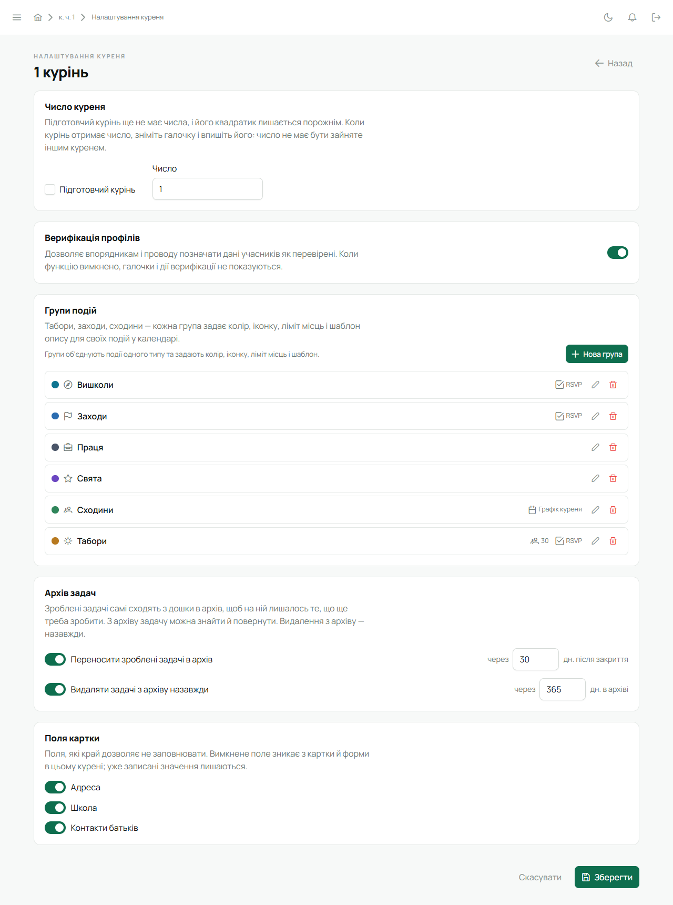
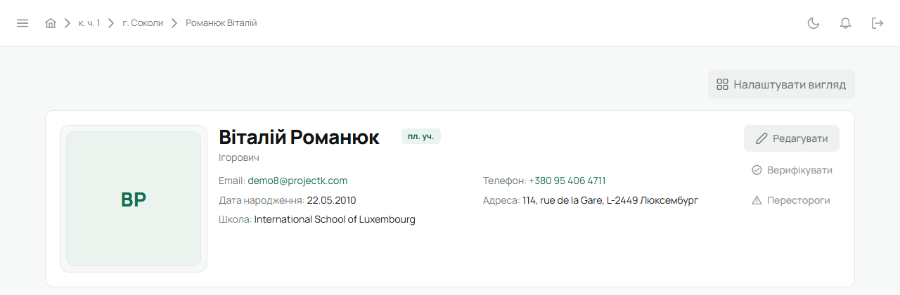

Верифікація — позначка, що дані в картці звірені з документами чи з батьками. Вона необовʼязкова:
курінь вирішує сам, чи користуватися нею.

## Увімкнути в курені

Робить Звʼязковий, один раз:

1. «Курінь» → **«Редагувати»** → **«Налаштування куреня»**.
2. У плитці **«Верифікація профілів»** увімкни перемикач і натисни **«Зберегти»** внизу.

Після цього в картках і списках зʼявляється значок верифікації, а в шапці картки — кнопка для неї.

## Підтвердити дані юнака

Може впорядник свого гуртка або Звʼязковий. Свою власну картку верифікувати не можна.

1. Відкрий картку юнака і звір імʼя, дату народження, ступені, контакти. Якщо щось не так —
   спершу виправ через **«Редагувати»** і збережи.
2. У шапці картки натисни **«Верифікувати»**.
3. Лілейка спитає **«Підтвердити, що дані в профілі правильні?»** — натисни **«Верифікувати»**.
   Зʼявиться «Профіль верифіковано.»

   

У картці й у списках біля імені зʼявиться зелений значок із підказкою **«Дані верифіковано»**, а
в картці — дата перевірки. Юнак отримає сповіщення **«Профільні дані підтверджено»**.

## Коли позначка застаріває

Якщо потім у картці змінити щось суттєве — імʼя, по батькові, дату народження, контакти,
ступені, гурток — значок стане сірим, а підказка скаже **«Дані змінено після
верифікації»**, а впорядники гуртка й Звʼязковий отримають сповіщення **«Профіль потребує повторної
перевірки»** (крім того, хто сам вніс зміну). Перевір зміни і натисни **«Верифікувати»** ще раз.

Ступені може вписати й сам юнак — тоді верифікація так само знімається, доки провід її не
перевірить.

## Зняти верифікацію

Коли профіль верифіковано, на місці кнопки стоїть **«Зняти верифікацію»**. Натисни її й підтвердь
**«Зняти»** — профіль знову чекатиме перевірки.

## На телефоні

Картка юнака → **«Редагувати»** → розділ **«Верифікація профілю»** → **«Верифікувати профіль»**.
