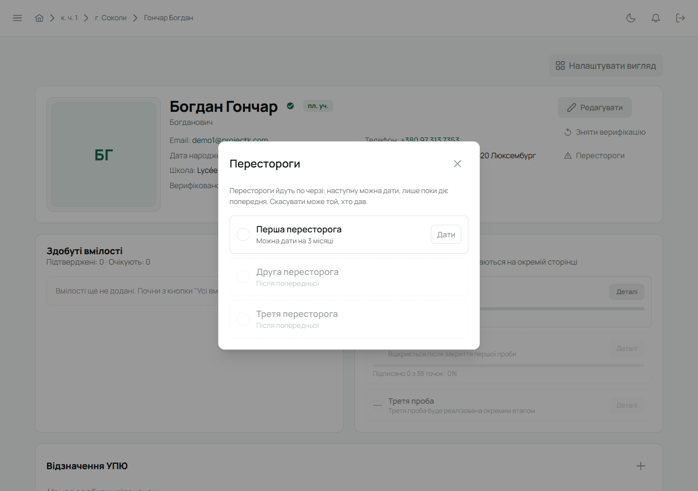

Пересторога — офіційне зауваження юнакові. Її виносить впорядник свого гуртка або Звʼязковий.
Юнак одразу отримує сповіщення «Пересторогу призначено».

## Рівні

| Рівень | Діє |
|---|---|
| Перша пересторога | 3 місяці |
| Друга пересторога | 6 місяців |
| Третя пересторога | 12 місяців |

Перестороги йдуть по черзі: наступну можна дати, лише поки діє попередня. Другу не винести без
першої — біля неї стоїть «Після попередньої».

## Кроки

1. Відкрий картку юнака і натисни **«Перестороги»** в шапці (на власній картці цієї кнопки
   немає).
2. Відкриється вікно **«Перестороги»** з трьома рівнями. Біля того, який можна дати зараз, написано
   «Можна дати на 3 місяці» (чи на 6, на 12) і є кнопка **«Дати»**.
3. Натисни **«Дати»**. Лілейка перепитає, наприклад «Дати першу пересторогу на 3 місяці?», —
   підтвердь **«Дати»**. Пересторога діє одразу, окремо зберігати нічого не треба.

Окремого поля для причини немає — поясни юнакові словами або запиши в нотатці на сходинах.

Біля чинної перестороги у вікні видно, до якої дати вона діє. На картці юнака біля імені
зʼявляться три крапки: скільки з них зафарбовано — такий рівень діє. Наведи на них, щоб побачити
рівень і скільки днів лишилось.

## Скасувати

Скасувати пересторогу може лише той, хто її дав: у тому самому вікні біля неї є **«Скасувати»**.
Лілейка попередить, що пересторога перестане діяти зараз, а не в кінці строку, — підтвердь
**«Скасувати пересторогу»** або натисни **«Лишити»**. Інші цієї кнопки не бачать. Коли термін
минає, пересторога перестає діяти сама.

## На телефоні

Картка юнака → **«Редагувати»** → розділ **«Перестороги»** — ті самі три рівні.
