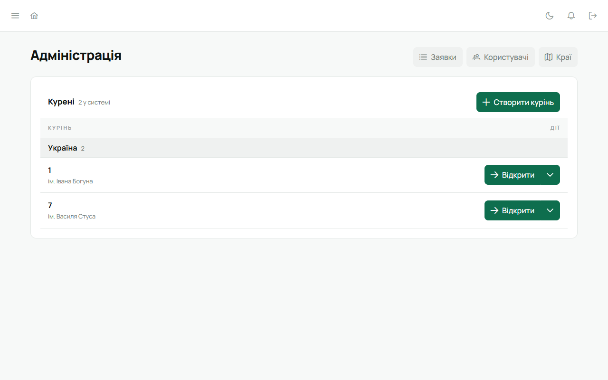
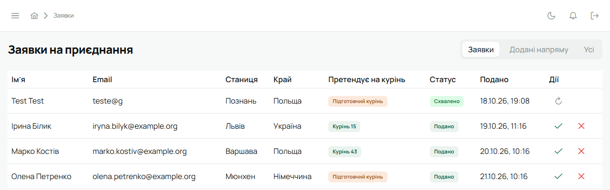

Адміністратор веде саму систему, а не курінь: відкриває нові курені, вирішує заявки на
приєднання, керує акаунтами. У кожному курені він може все, що й Звʼязковий, але сам не є
членом куреня.

Адміністратор має увімкнути [двофакторний вхід](/user/howto/enable-mfa/). Якщо на вашій
інсталяції це обовʼязково, Лілейка попросить налаштувати його одразу після входу.

:::tip[Свій робочий акаунт поруч]
Якщо ти водночас Звʼязковий чи впорядник у курені, тримай обидва акаунти на одному пристрої й
перемикайся між ними без пароля — див. [Перемкнути акаунт](/user/howto/switch-account/).
:::

## Адміністрація

Після входу адміністратор потрапляє на сторінку **«Адміністрація»** (вона ж — пункт бічного
меню). Тут список усіх куренів, згрупований за краями, і кнопки **«Заявки»**, **«Користувачі»** та
**«Краї»**.

- **«Відкрити»** — зайти в курінь і працювати в ньому як Звʼязковий. Повернутися — кнопка
  **«До адміністрації»** вгорі.
- Стрілка біля «Відкрити» → **«Редагувати»** (змінити число куреня чи **«Край»**) або
  **«Видалити»**. Лише тут курінь переходить в інший край; поле «Край» у даних самого куреня —
  просто підпис.
- **«Створити курінь»** — новий курінь із числом і краєм. Якщо край не вибрати, курінь стане в
  типовий край інсталяції. Число куреня має бути унікальним у межах краю: у різних краях можуть
  бути курені з однаковим числом. Зазвичай курені зʼявляються самі, коли
  адміністратор схвалює заявку Звʼязкового (нижче), тож створювати вручну доводиться рідко.
- Підготовчий курінь (ще без числа) показується як **«Підготовчий»** з іменем, на честь кого він.
  Детально — [Підготовчий курінь](/user/howto/preparatory-kurin/).

## Заявки на приєднання

Новий курінь приходить у Лілейку через заявку: Звʼязковий заповнює форму на сайті (`/join`), а
адміністратор її вирішує. Коли є заявка, що чекає рішення, біля пункту «Адміністрація» в бічному
меню світиться крапка.

1. **«Адміністрація»** → **«Заявки»**.
2. Вгорі — фільтр: **«Заявки»** (типово — те, що подали люди), **«Додані напряму»** (кого провід
   додав сам, без заявки) і **«Усі»**.
3. У рядку заявки:
   - ✓ **«Схвалити й надіслати запрошення»** — відкриває вікно **«Схвалити заявку»** з полем
     **«Край куреня»**: там уже стоїть край, який Звʼязковий обрав у формі. Якщо обрано не той,
     зміни його тут. Якщо заявник вписав край текстом (список країв тоді не завантажився), під
     полем буде підказка «Заявник написав: «…»», а саме поле стоїть на типовому краї інсталяції.
     **«Схвалити»** — курінь одразу зʼявиться в списку (з числом із заявки або підготовчий) у цьому
     краї, а Звʼязковому піде лист із посиланням для активації. Активувавши акаунт, він стає
     Звʼязковим цього куреня. Якщо в цьому краї курінь із таким числом уже є, схвалення не пройде:
     Лілейка скаже, що число зайняте;
   - ✗ **«Відхилити»** — можна вписати причину відмови. Відхилений може подати заявку знову з тією
     самою поштою;
   - ↻ **«Надіслати запрошення ще раз»** — для вже схвалених, якщо лист не дійшов.
4. Позначка **«Підготовчий курінь»** у колонці «Претендує на курінь» означає, що курінь ще без
   числа. Колонка «Край» показує назву краю із заявки.

Статуси заявок: «Подано», «Потрібна перевірка», «Перевірено», «Схвалено», «Відхилено».

## Користувачі

**«Адміністрація»** → **«Користувачі»**: усі акаунти системи, згруповані за куренями, з пошуком за
імʼям або email.

У рядку користувача:

- **олівець** → змінити **роль**: «Адміністратор» або «Учасник». Ролі в курені (Звʼязковий,
  впорядник, провід) тут не змінюються — їх призначають у самому курені;
- **«Призупинити акаунт»** — людина більше не може увійти, її сесії на всіх пристроях закінчуються
  одразу. Дані лишаються. **«Поновити акаунт»** повертає вхід;
- **«Видалити користувача»** — прибрати акаунт.

## Краї

**«Адміністрація»** → **«Краї»**. Тут налаштування кожного краю, спільні для всіх його куренів.
Вгорі — вибір **«Край»** і номер чинної ревізії. Поки є незбережені зміни, перейти до іншого краю
не вийде.

Усі 28 країв із глобального сайту Пласту в Лілейці вже є: Україна, Чехія, Польща, Словаччина,
Канада й решта, кожен зі своєю валютою й часовим поясом. Край, який зареєструють пізніше, додає
**«Новий край»**: **«Назва»** і **«Код»** — дволітерний код країни латиницею (скажімо, `no` для
Норвегії), за ним поле телефону пропонує країну. Код потім не змінити, назву можна: **«Назва
краю»** → **«Перейменувати»**. Новий край бере українські вмілості, гривню й київський час, тож
налаштуй його профіль одразу після додавання.

- **Вмілості** — **«Краї, з яких беруться вмілості»** (якщо нічого не вибрано, курені бачать
  вмілості свого краю) і перелік вмілостей із перемикачем біля кожної: вимкнену курені краю почати
  не можуть. Є пошук за назвою.
- **Картка члена** — для полів **«По батькові»**, **«Номер телефону»**, **«Адреса»**, **«Школа»** і
  **«Контакти батьків»** обери **«Обовʼязкове»**, **«Необовʼязкове»** чи **«Приховане»** (приховане
  зникає з картки й форми). Нижче — **«Поля краю»**: власні поля, які заповнюють у картці кожного
  члена, як-от тип візи. У кожного є **«Назва»**, **«Ключ»** (латиницею, після збереження не
  міняй — під ним лежать значення), **«Тип»** («Текст» чи «Дата») і перемикач **«Обовʼязкове»**.
  **«Додати поле»** додає ще одне.
- **Пільги краю** — власні пільги й знижки, які гуртки краю можуть надати людині поверх пільги
  куреня. У кожної є **«Назва»**, **«Як знижує»** («Знижка у відсотках», «Знижка на суму» чи
  «Повне звільнення»), **«Відсоток»** або **«Сума за квартал»** і **«Що знижує»**: «Станиця»,
  «Край», «Курінь», «Гурток». **«Додати пільгу»** додає ще одну, кошик прибирає. Зміна правила діє
  лише на пільги, надані після збереження. Як їх надають —
  [Вкладка](/user/features/dues/#ставки-й-пільга).
- **Валюта, час і вкладка**:
  - **«Валюта»**, у якій курені краю ведуть вкладку;
  - **«Запис чисел»** — розділювач тисяч і копійок у сумах вкладки;
  - **«Часовий пояс»** — за ним повторюються події й починається новий квартал вкладки;
  - **«Куди курені передають вкладку»** — «Станиці, а вона — краю», «Напряму краю» чи «І станиці,
    і краю — за статтями». Від цього залежить, кому можуть іти статті вкладки куреня і які
    передачі є в касі куреня; задані раніше статті не змінюються.

  Порожнє поле означає «Як за замовчуванням»: гривня, український запис чисел (`uk-UA`) і типовий
  пояс інсталяції.

Зміни записує **«Зберегти»** — і профіль, і пільги краю разом; поруч можна коротко вписати, що
змінено. **«Скасувати»** відкидає незбережене.

**Звіт про пільги** — обери **«Квартал»**, і Лілейка покаже, скільки людей у куренях краю мають
пільгу краю і на скільки разом менша вкладка. У таблиці рядок на пільгу (з розкладом за куренями) і
колонки «Пільга», «Людей», «Станиця», «Край», «Курінь», «Гурток», «Разом».

**Історія** — кожне збереження стає окремою ревізією з датою, автором і приміткою.
**«Відновити»** біля старої ревізії повертає її як нову, нічого не стираючи. **«Експорт JSON»**
вивантажує профіль краю у файл, **«Імпорт JSON»** завантажує такий файл назад.

## Система

Бічне меню → **«Системні налаштування»**. Тут один перемикач: **«Обовʼязкова MFA для привілейованих
ролей»** — вимагати двофакторний вхід від адміністраторів і Звʼязкових.

## На телефоні

У мобільній версії в «Меню» адміністратора є **«Заявки»** — їх можна вирішувати з телефона.
Схвалена з телефона заявка відкриває курінь у краї, обраному в заявці (якщо край вписано текстом —
у типовому краї інсталяції); змінити край там не можна — для цього схвали заявку у вебі.
«Адміністрація», «Користувачі» й «Системні налаштування» відкривають веб, а «Краї» є лише у вебі.

## Власний сервер

Якщо Лілейку розгорнуто на сервері вашої станиці чи куреня, першого адміністратора створює майстер
налаштування при першому запуску — див. [Власний сервер](/user/self-host/).
