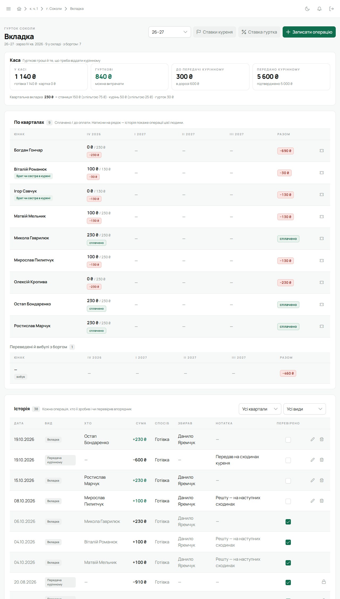

Впорядник — той, кого Звʼязковий закріпив за гуртком у плитці «КВ». Усе нижче стосується **твоїх**
гуртків; інші видно, але не редагуються. Хто що може — [Ролі та діловодства](/user/start/roles/).

## Сторінка гуртка

Відкривається зі сторінки «Курінь» (плитка «Гуртки» → «Відкрити»), з головної («Мої курені та
гуртки») або з картки юнака. Тут сильветка й опис гуртка, провід гуртка, склад, дні народження.

Кнопка **«Редагувати»** відкриває меню:

- **Редагувати профіль** — назва й опис гуртка;
- **Додати учасника** — форма нової людини: імʼя, пошта, телефон, дата народження, школа, адреса,
  контакти батьків, поля від краю, ступені. Які з них обовʼязкові, вирішує край куреня: телефон,
  наприклад, можна лишити порожнім, якщо край це дозволяє. На пошту одразу піде запрошення з
  активацією; попроси перевірити «Спам»;
- **Завантажити сильветку** — обери зображення й варіант обробки: «Чорно-біле», «Обводка» (з
  «Товщиною»), або **«Без обробки»**.

**Провід гуртка** — гуртковий, суддя, писар, скарбник та інші: шестерня «Налаштувати провід» у
плитці. Гурткового призначаєш саме ти (або Звʼязковий) — [Записати провід](/user/howto/assign-leadership/).

Картку юнака редагуєш кнопкою «Редагувати» на ній: дані, фото, ступені. Поруч у шапці картки —
«Верифікувати» і «Перестороги» — [Картка учасника](/user/features/member-card/).

## Проба

Картка юнака → плитка «Проба» → **«Деталі»**. Біля кожної точки — **«Підписати»**; підпис лишає твоє
імʼя й дату. Коли підписано все — **«Здати і закрити пробу»**. Покроково —
[Підписати й закрити пробу](/user/howto/close-probe/).

## Вмілості й відзначення

Юнак (або ти за нього) подає вмілість; черга — у бічному меню **«Модерація вмілостей»**. Там
підтвердь або відхили з поясненням. Відзначення УПЮ підтверджуєш на картці юнака. Покроково —
[Вмілості й відзначення](/user/howto/skills-and-awards/).

## Календар і задачі

- **Календар** — сходини, табори й заходи. Створюючи подію, вкажи, для кого вона: гурток, курінь чи
  конкретні люди. Є повторення (щотижневі сходини) і відповіді «Іду / Можливо / Не йду» —
  [Створити подію](/user/howto/create-event/).
- **Задачі** — дошка задач: призначити юнакові чи гуртку, поставити термін, відмітити зроблене.
  Задачу гуртку можна дати «кожному окремо» — тоді в деталях видно, хто зробив, а хто ні, і можна
  відмітити за юнака — [Створити задачу](/user/howto/create-task/).

## Перестороги й верифікація

- **Пересторогу** даєш кнопкою «Перестороги» в шапці картки юнака: три рівні по черзі, без поля
  причини. Юнак отримує сповіщення — [Винести пересторогу](/user/howto/warning/).
- **Верифікація** — якщо курінь її ввімкнув, перевір дані юнака й натисни «Верифікувати» в шапці
  картки — [Верифікувати профіль](/user/howto/verify-profile/).

Типово впорядник дає перестороги й підтверджує відзначення всіх рівнів, підписує й знімає підписи
проб і підтверджує вмілості свого гуртка. Курінь може це змінити — наприклад, лишити третю
пересторогу чи четверте відзначення лише Звʼязковому — див.
[Права й видимість](/user/howto/access-policy/). Видаляти чи змінювати вже підтверджене
відзначення типово може лише Звʼязковий. Кнопки на картці показують рівно те, що тобі дозволено.

Усе, що ти й інші підписали чи змінили, видно в **«Журналі дій»** у бічному меню —
[Журнал дій](/user/features/journal/).

## Каса гуртка і точкування

- **Вкладка гуртка** в бічному меню — каса твого гуртка: внески юнаків, передачі курінному, витрати.
  Ти позначаєш операції «Перевірено» — [Вкладка](/user/features/dues/).

  Пільги даєш значком **«Пільга»** в рядку юнака: у вікні **«Пільги»** — пільга куреня, а нижче
  **«Пільги краю»**: у полі **«Надати пільгу»** обери пільгу краю, потім **«З кварталу»**, за
  бажанням **«До кварталу»** і **«Підстава»** → **«Надати»**. Передачу курінному, яку скарбник куреня вже прийняв, не змінити й
  не видалити: біля неї замок, доки він не зніме підтвердження.

  

- **Точкування** — відмічай присутність на аркуші події (кнопка «Точкування» в календарі) і давай
  бали своєму гурткові — [Точкування](/user/features/score/).

  

- На [головній](/user/features/dashboard/) плитка **«Справи»** нагадає про вмілості на перевірку,
  неперевірені операції й сходини без відміченої присутності.

## На телефоні

Майже все це є в мобільній версії: вкладка «Курінь» → гурток, картка юнака з пробою й
вмілостями, «Модерація вмілостей», «Вкладка гуртка» й «Точкування» в «Меню», календар і задачі
окремими вкладками. Детально — [Лілейка на телефоні](/user/features/mobile-app/).

## Чого впорядник не може

Змінювати провід куреня, склад КВ, налаштування куреня, імпортувати склад, переводити людей між
гуртками й виводити з куреня, вивантажувати PDF-звіт. Це — [Звʼязковий](/user/roles/leader/).
