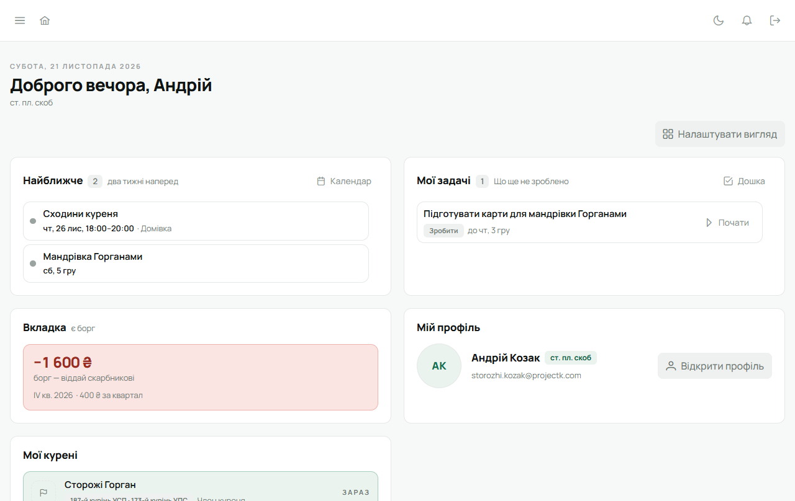
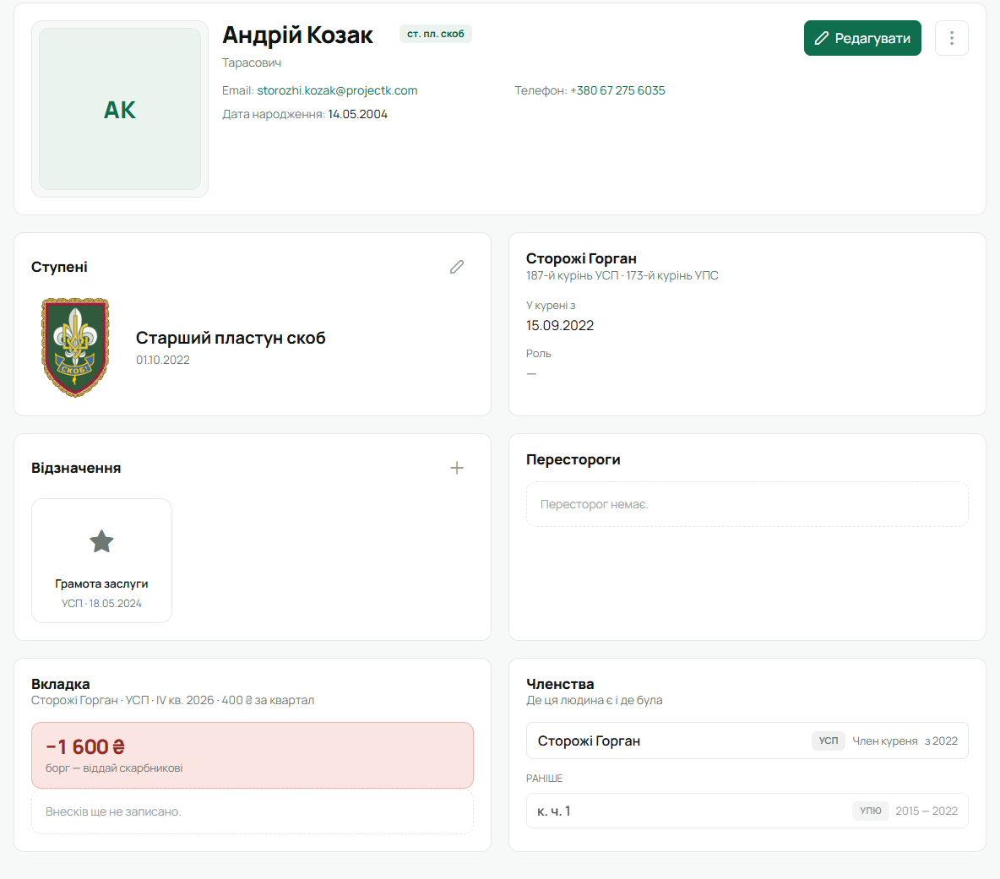
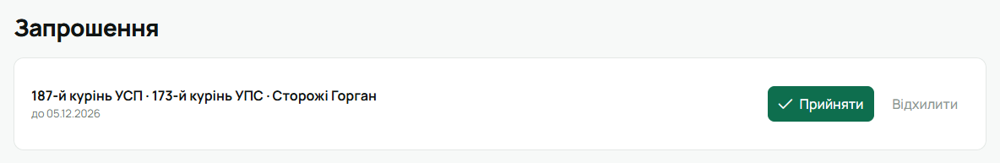

У старшому курені ти — **член куреня**, як і всі. Гуртків тут немає, натомість членство розрізняють
[тегами](/user/features/tags/). Як влаштований сам
курінь — [Старший курінь (УСП/УПС)](/user/features/senior-kurin/).

У Лілейку ти потрапляєш одним із двох шляхів: провід додає тебе в курінь і на пошту приходить лист
([Перший вхід](/user/start/first-login/)), або курінь надсилає тобі запрошення (див.
[«Запрошення»](#запрошення)).

## Головна

[Головна](/user/features/dashboard/) показує найближчі події (де подія просить відповіді — з «Іду / Можливо / Не йду»),
твої справи й задачі, свій рахунок у вкладці, свій профіль і курені, де ти є. Плиток «Проба» й
«Вмілості» тут немає, а «Точкування» — лише якщо курінь його веде. Плитки можна переставити й сховати.

## Твоя картка

Бічне меню → **«Мій профіль»**. Під іменем — твої теги, якщо курінь їх тобі показує. Плитки
[картки](/user/features/member-card/) в старшому курені:

- **‹назва куреня›** — **«У курені з»** і **«Роль»** (прочерк, якщо ролі немає). Назви ролей курінь може
  мати свої;
- **«Ступені»** — найвищий ступінь великим, з рисунком;
- **«Відзначення»** — відзначення УСП і УПС;
- **«Перестороги»** — винесені тобі, а якщо їх не було, «Пересторог немає.»;
- **«Вкладка»** — твій рахунок;
- **«Членства»** — де ти є і де був.

Свою пошту, телефон і пароль змінюєш у **«Налаштування»** → вкладка **«Акаунт»** —
[Акаунт](/user/account/).

### Ступені

Свої ступені вписуєш сам: олівець на плитці **«Ступені»** або **«Редагувати»** → **«Пластові
ступені»** → **«Додати ступені УСП/УПС»**. Якщо ти вже в УСП чи УПС, вписаний ступінь рахується
одразу.

Якщо ти ще юнак у курені УПЮ, ступінь старшого пластуна чи сеніора спершу підтверджує Звʼязковий.
Доти біля нього на плитці написано **«чекає підтвердження»** — [УПЮ, УСП, УПС](/user/features/branches/).

### Відзначення

Відзначення УСП і УПС вносиш ти або провід куреня: вибираєте з переліку, розгляду немає. У курені
УПЮ, де ти впорядник, старші відзначення вносиш собі лише сам, і лише з **18** років.

### Твоє юнацтво

Пройдені проби, вмілості й відзначення УПЮ на картці члена старшого куреня не видно. Вони не
зникають: їх видно в [Пластовому життєписі](/user/features/life-story/).

## Вкладка

Твій рахунок — у касі куреня, без гуртка. На картці й на головній видно «Сплачено», борг із
підказкою «віддай скарбникові» або надлишок, ставку поточного кварталу й останні внески. Скільки ти
платиш, залежить від твоїх тегів; заплатити можна й наперед. Поки за минулі квартали є борг, тебе не
виведуть з куреня й не відпустять в інший — [Вкладка старшого куреня](/user/features/dues-senior/).

## Запрошення

Коли старший курінь хоче тебе прийняти, а відповідати маєш ти сам, приходить сповіщення, а в меню
акаунта (твоя пошта внизу бічного меню) зʼявляється **«Запрошення N»**. На сторінці **«Запрошення»**
біля кожного куреня — строк і кнопки **«Прийняти»** та **«Відхилити»**. Запрошення діє 14 днів.
Якщо ти ще в УПЮ, Лілейка відповість **«Ти ще в УПЮ.»**

Щоб курінь міг тебе знайти, дай Звʼязковому свій код: меню акаунта → **«Мій код для переходу»**.
Покроково — [Перевести людину між куренями](/user/howto/transfer-member/#5-людина-відповідає-на-запрошення).

## Кілька куренів

Членом можна бути лише одного старшого куреня. Інший старший курінь може тебе тільки перевести до
себе. Водночас ти можеш бути впорядником у курені УПЮ.

Курінь, у якому ти зараз, видно вгорі сторінки. Клікни на нього, щоб перемкнутися. Від куреня
залежать меню, права й те, що видно на картці. Вкладка в кожному курені своя.

## Пластовий життєпис

На своїй картці **«Ще»** → **«Пластовий життєпис»**: ступені, юнацтво, старші відзначення,
членства, ролі, вишколи й табори в одному місці, з PDF. Бачиш його лише ти — [Пластовий життєпис](/user/features/life-story/).

## Своя картка за посиланням

Меню акаунта → **«Показати картку»** — QR твоєї картки. Він діє 3 хвилини: його показують
комусь поруч. Постійне посилання й те, що видно на картці, — у **«Налаштування»** → **«Акаунт»** →
**«Моя картка»**. Повнолітній налаштовує це сам — [Показати картку й поділитися нею](/user/howto/share-card/).

## На телефоні

На телефоні — вкладки «Головна», «Календар», «Задачі», «Курінь» і «Меню». У «Меню» —
**«Показати картку»**, **«Мій код для переходу»**, **«Сканувати QR»**, а ще **«Запрошення»**, коли
вони є, і **«Мої курені»**, коли ти в кількох. Життєпису на телефоні немає —
[Лілейка на телефоні](/user/features/mobile-app/).
